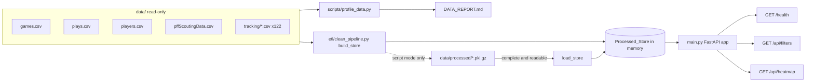
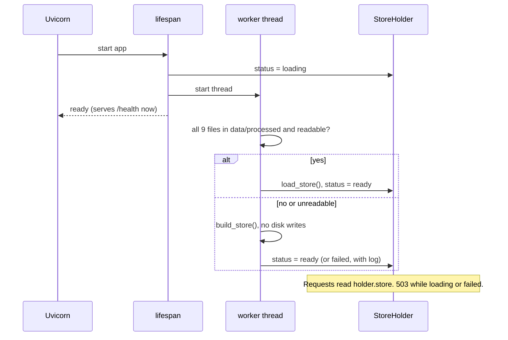
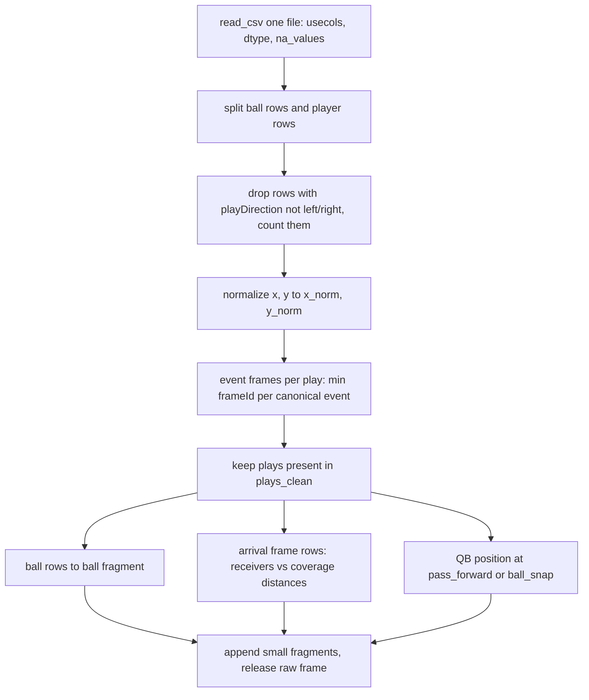

# Design Document

## Overview

This design covers two ordered stages for the NFL Big Data Bowl UNAM project.

1. **ETL stage.** `backend/scripts/profile_data.py` audits the raw files and writes `DATA_REPORT.md`. `backend/etl/clean_pipeline.py` reads the 122 tracking files one at a time, normalizes coordinates, labels phases, derives play metrics and builds a set of pre-aggregated tables (the Processed_Store).
2. **API stage.** `backend/main.py` exposes `app` with `GET /health`, `GET /api/filters` and `GET /api/heatmap`. At startup the API loads the Processed_Store from `data/processed/` when it is complete. Otherwise it builds the store in memory. Requests are answered with numpy/pandas operations on in-memory tables.

The design stays inside the fixed stack (Python 3.12.12, FastAPI 0.115.14, Uvicorn 0.34.3, Pydantic 2.11.7, pandas 2.2.3, numpy 2.1.3, pytest 8.3.5, httpx 0.28.1). It adds no dependency and uses no `pyarrow`.

### What the real data looks like

These facts were measured on the files in `data/` and drive several decisions below.

| Fact | Value | Consequence |
|---|---|---|
| Files | `games.csv` 122 rows, `plays.csv` 8,557 rows, `players.csv` 1,679 rows, `pffScoutingData.csv` 188,254 rows, `tracking/` 122 files, 811 MB | One game per tracking file, so a play never spans two files. A per-file reduction is complete. |
| Tracking columns | `gameId, playId, nflId, frameId, time, jerseyNumber, team, playDirection, x, y, s, a, dis, o, dir, event` | There is **no `displayName`** in tracking. Names come from `players.csv` by `nflId`. See "Tracking column set". |
| Missing values | Literal `NA` in `plays/players/pff`; tracking `event` uses `None`; ball rows have `nflId` = NA | `na_values=["NA", "None"]` on every read. |
| Read speed | About 0.12 s per tracking file with 10 columns and explicit dtypes (about 73k rows, about 3 MB in memory) | The full tracking pass takes roughly 15 to 30 s. |
| `passResult` | Non-null on all 8,557 plays (`C` 4,620, `I` 2,755, `S` 543, `R` 449, `IN` 190) | Every play in `plays.csv` is a dropback pass play. Requirement 5.12 still filters explicitly. |
| `pff_role` | `Coverage`, `Pass Block`, `Pass Route`, `Pass Rush`, `Pass` (the QB) | `Pass` identifies the quarterback for `pocket_pressure`. |
| Tracking window | Frames end **5 frames (0.5 s) after `pass_forward`** on all 7,604 plays that have a release event (max 5, mean 4.996) | Tracking does not follow the ball to the catch. See "Event coverage". |
| Events | `ball_snap` in 8,532 plays, plus `autoevent_ballsnap` in 3,757. `pass_forward` in 7,547, plus `autoevent_passforward` in 3,734. `pass_arrived` in only **367** (4.3%). `autoevent_passinterrupted` in 201. No release event in 953 plays. No snap event in 24 plays. | Strict use of `pass_arrived` leaves the `targets`, `routes` and `separation` layers with 4% of plays. See "Event coverage". |
| Direction | `playDirection` is `left` or `right` in the sample checked | Rows with another value are excluded and counted (Requirement 3.9). |

### Key design decisions

1. **Build in a background thread, serve `/health` immediately.** The store loads in a worker thread started from the FastAPI lifespan. `/health` never waits on it (Requirement 7.8).
2. **Pre-aggregate per play, filter at request time.** Grid tables hold one row per play (or per play and player) with the 5-yard bin already computed. A request builds a boolean mask over the 8,557 plays and aggregates a few thousand grid rows. This keeps `/api/heatmap` far below 500 ms without caching.
3. **gzip pickle for persistence.** `DataFrame.to_pickle(path, compression="gzip")` preserves dtypes, column order and nullable integer types exactly, which Requirement 6.2 demands. gzip CSV would lose dtypes. Pickle files are only read from the project's own `data/processed/` directory.
4. **Pure functions for all logic.** Normalization, phase labelling, metrics, target inference, binning and aggregation take and return DataFrames or arrays with no I/O, so they can be tested without files.
5. **Two documented deviations from literal requirement text** (event aliasing and last-frame fallback), controlled by constants. They are listed in "Requirement amendments proposed". Both exist because of the measured data above.

### Research notes

- pandas `read_csv` accepts `usecols`, `dtype` and `na_values` together. The C engine releases the GIL while parsing, so a worker thread does not block `/health` for long. ([pandas read_csv](https://pandas.pydata.org/docs/reference/api/pandas.read_csv.html))
- FastAPI 0.115 supports the `lifespan` context manager for startup and shutdown work. `on_event` is deprecated. ([FastAPI lifespan events](https://fastapi.tiangolo.com/advanced/events/))
- `CORSMiddleware` with `allow_origins=["http://localhost:5173"]` adds `Access-Control-Allow-Origin` to responses for requests carrying that `Origin`. ([FastAPI CORS](https://fastapi.tiangolo.com/tutorial/cors/))
- `pyarrow` is not in the stack, so Parquet and Feather are unavailable. pandas pickle with gzip compression is built in.

## Architecture



### Startup sequence



### Per-file tracking reduction



Only fragments (ball rows, one row per play, one row per receiver) survive the loop. The raw frame is deleted at the end of each iteration.

## Components and Interfaces

### Module layout

```
backend/
  main.py                    app, cargar_env(), lifespan, 3 endpoints, CORS
  schemas.py                 Pydantic response models
  store.py                   Store dataclass, StoreHolder, save_store, load_store, load_or_build
  heatmap.py                 filter mask, meta, grid, top players (pure functions)
  etl/
    __init__.py
    constants.py             column lists, dtypes, event aliases, layer names, grid size
    normalize.py             normalize_frame()
    phases.py                event_bounds(), label_phases(), time_to_throw()
    metrics.py               pressure_counts(), separation_at_frame(), qb_position()
    targets.py               infer_targets()
    clean_pipeline.py        build_store(), main()
  scripts/
    __init__.py
    profile_data.py          main()
  tests/                     pytest suite
```

`backend/main.py` already exists as a minimal app and `backend/__init__.py` exists. Run with `.venv/bin/uvicorn backend.main:app`. Imports use the `backend.` prefix.

### `backend/main.py`

- First lines: `import os`, `from pathlib import Path`, then `cargar_env()` defined exactly as in the project rules and called once at module level. No `boto3` import exists in this feature. The snippet is placed before any other project import.
- `CORSMiddleware` with `allow_origins=["http://localhost:5173"]`, `allow_methods=["GET"]`, `allow_headers=["*"]`.
- `lifespan` creates a `StoreHolder` on `app.state.holder` and starts a daemon thread that runs `load_or_build()`.
- Endpoints:
  - `GET /health` returns `{"status": "ok"}` and never touches the holder.
  - `GET /api/filters` returns the `FiltersResponse` built from the store.
  - `GET /api/heatmap` validates parameters, then calls `heatmap.compute_heatmap()`.
- `get_holder(request)` is a FastAPI dependency. Tests replace it through `app.dependency_overrides`.
- The three routes are the only application routes. Serving `dashboard/dist` is out of scope for this spec. When added later it must be mounted last so `/api` and `/health` keep precedence.

### Store and holder (`backend/store.py`)

```python
TABLE_NAMES = (
    "plays", "ball", "receivers", "rushers", "players",
    "grid_targets", "grid_routes", "grid_pocket_pressure", "grid_separation",
)

@dataclass(frozen=True)
class Store:
    tables: dict[str, pd.DataFrame]      # keys == TABLE_NAMES

class StoreHolder:
    status: Literal["loading", "ready", "failed"]
    store: Store | None
    error: str | None

def save_store(store: Store, out_dir: Path) -> None          # script mode only
def load_store(in_dir: Path) -> Store                        # raises on missing/unreadable file
def load_or_build(processed_dir: Path, data_dir: Path) -> Store
```

- `load_or_build` returns `load_store` output when all nine `*.pkl.gz` files exist and read. On any missing or unreadable file it logs a warning and returns `build_store(data_dir)`. It never writes or deletes.
- The file name is `data/processed/<table>.pkl.gz`.
- `load_store` also checks that every `pidx` in grid tables is smaller than `len(plays)`. A failed check counts as unreadable.
- The holder is written once by the worker thread (status and store assigned together) and then only read.
- `save_store` is called only from `clean_pipeline.main()` (script mode, `python -m backend.etl.clean_pipeline`), which is the **Persist_Run**. The API module imports only `load_store`, `load_or_build` and `StoreHolder` on its code path and never calls `save_store`.
- The API reads `data/processed/` only at startup, inside the worker thread. No request handler touches that directory, and no code path in the API creates, modifies or deletes a file there (Requirements 6.7, 6.8, 6.14, 13.4).

**Persist_Run write protocol (`save_store`).**

1. `out_dir.mkdir(parents=True, exist_ok=True)` creates `data/processed/` when absent (Requirement 6.11).
2. For each table in `TABLE_NAMES` order: write to `<table>.pkl.gz.tmp` in `out_dir` with `to_pickle(..., compression="gzip")`, then `os.replace(tmp, final)`. `os.replace` is atomic on the same filesystem, so a final name never holds a partial file (Requirement 6.12).
3. On any exception while writing or renaming a table, the `except` block removes that table's temporary file (ignoring a missing file), logs the table name and the error, and re-raises as `PersistError`. `main()` catches it and returns exit code 1 (Requirement 6.13). Tables already renamed earlier in the run stay in place, and the API treats a directory with fewer than nine files as incomplete, so a failed Persist_Run cannot cause a half-loaded store.
4. A stale `*.tmp` file left by a killed process is ignored by `load_store` (it only looks for the nine final names) and is overwritten by the next Persist_Run.
5. After the last rename `save_store` returns, and `main()` logs the output directory and returns 0. Success leaves no `*.tmp` file.
- Delivery note for Requirement 6.10: `.gitignore` excludes `data/processed/`, so the deployed server rebuilds the store in memory at startup. The README states this. The team may remove that `.gitignore` line to ship the processed files (a few MB) and skip the 15 to 30 s build.

### Cleaning pipeline (`backend/etl/clean_pipeline.py`)

```python
def build_store(data_dir: Path = DATA_DIR, *,
                allow_last_frame_fallback: bool = True) -> Store
def main() -> int          # Persist_Run: builds, saves to data/processed, returns exit code
```

`main()` returns 0 on success and 1 on `NoTrackingDataError` or `PersistError`. The README documents the command `.venv/bin/python -m backend.etl.clean_pipeline` as the Persist_Run, and states that a deployed server without `data/processed/` rebuilds the store in memory at each startup (Requirements 6.10, 6.15).

Steps inside `build_store` (no disk writes):

1. Read `plays.csv`, `players.csv`, `pffScoutingData.csv` with `na_values=["NA", "None"]`. Keep plays with non-null `passResult`. Sort by `gameId, playId` and assign `pidx = 0..n-1`.
2. `targets.infer_targets()` resolves `target_nflId` per play (see "Targeted receiver inference").
3. `metrics.pressure_counts()` computes `n_hurry`, `n_hit`, `n_sack`, `pressure`.
4. Loop over `sorted(glob("tracking_*.csv"))`. Each iteration reads one file, reduces it to fragments, logs file name, and deletes the frame. A parse error is logged with file name and error, the partial data of that file is discarded (fragments are appended only after the file reduces cleanly), the file counts as skipped, and the loop continues.
5. After the loop, log `processed`, `skipped` (processed + skipped equals files found). If processed is 0, log an error and raise `NoTrackingDataError`. `main()` converts that to exit code 1. The API holder converts it to `failed`.
6. Finalize tables: concatenate fragments, join them to `plays`, compute bins, sort deterministically, fix dtypes. Each table is timed, and one log line per table reports name, seconds (`%.2f`) and row count. For tables produced inside the loop, the logged time is the finalize time of that table.
7. Check that every table has at least one row, otherwise raise.

Determinism (Requirement 6.5): files are sorted, every table is sorted on explicit keys with a stable sort, no set or dict iteration order reaches the output, and dtypes are set explicitly.

### Tracking column set

The request mentioned player names in tracking. The real tracking files have no `displayName`. The pipeline reads exactly these columns and no others:

| Column | dtype | Why it is needed |
|---|---|---|
| `gameId` | int64 | play key |
| `playId` | int32 | play key |
| `nflId` | float64 (NaN for ball) | player key. float64 represents all ids exactly and holds NaN. |
| `frameId` | int16 | ordering, event frames |
| `team` | category | identifies `football` rows |
| `playDirection` | category | normalization |
| `x`, `y` | float64 | position. float64 keeps the 1e-9 round-trip tolerance of Requirement 3.7. |
| `s` | float64 | ball speed column in the ball table |
| `event` | category | phase boundaries |

Not read: `time`, `jerseyNumber`, `a`, `dis`, `o`, `dir`. No output table contains them (the ball table columns are fixed by Requirement 4.2), so Requirement 2.3 forbids loading them. `normalize_frame()` still transforms `o` and `dir` when those columns are present in its input, so Requirement 3 holds as a tested function and a future table can enable them by adding the two names to `TRACKING_COLS`. Names and positions of players come from `players.csv` (`displayName`, `officialPosition`) through the `players` table, joined on `nflId` at request time.

### Normalization (`etl/normalize.py`)

```python
def normalize_frame(df: pd.DataFrame) -> tuple[pd.DataFrame, int]
```

Input has `playDirection`, `x`, `y`, and optionally `o`, `dir`. Output is a copy that adds `x_norm`, `y_norm` and, when present, rewrites `o` and `dir`. The second value is the number of excluded rows.

- Rows with `playDirection` not in `{"left", "right"}` (including null) are excluded and counted. The pipeline logs the total.
- `left`: `x_norm = 120.0 - x`, `y_norm = 53.3 - y`, `o` and `dir` become `(v + 180) % 360`.
- `right`: copies of `x`, `y`; `o` and `dir` unchanged.
- Null stays null, rows are kept.
- The left transform is its own inverse for `x` and `y`. For angles it is an involution modulo 360. Inputs equal to 360 map to 0 under the `% 360` step, so the round trip is exact for inputs in `[0, 360)`; the property test uses that domain.

### Event bounds and phases (`etl/phases.py`)

```python
EVENT_ALIASES = {
    "snap":    ("ball_snap", "autoevent_ballsnap"),
    "forward": ("pass_forward", "autoevent_passforward"),
    "arrived": ("pass_arrived",),
}

def event_bounds(frames: pd.DataFrame) -> pd.DataFrame   # index gameId, playId; cols snap, forward, arrived (Int16)
def label_phases(frame_ids, snap, forward, arrived) -> np.ndarray   # object array of str or None
def time_to_throw(snap, forward) -> float | None
```

- `event_bounds` takes the **lowest `frameId`** for each canonical event (Requirement 4.9). Event rows appear on every player row of the frame, so grouping on `(gameId, playId, event)` and taking `min(frameId)` is enough. For each canonical event the manual name wins when a play has both manual and `autoevent_` rows. Otherwise the `autoevent_` frame is used. This is deviation A (see amendments).
- `label_phases` applies the rules of Requirements 4.4 to 4.7 and 4.8:
  - `frame < snap` gives `pre_snap` (needs only `snap`).
  - `snap <= frame < forward` gives `pocket_phase` (needs `snap` and `forward`).
  - `forward <= frame < arrived` gives `ball_in_air` (needs `forward` and `arrived`).
  - `frame >= arrived` gives `yac_phase` (needs `arrived`).
  - A frame whose rule needs a missing boundary gets `None`. The first matching rule among those with all boundaries present decides, but a frame is never labelled by a rule when an earlier rule it depends on is undecidable. Concretely: if `snap` is missing, only the `yac_phase` rule (needs `arrived` alone) and nothing else can label; `pre_snap` is not assumed.
  - If all three boundaries exist but are out of order (`forward < snap` or `arrived < forward`), every frame is `None` and the play is flagged `lacks_phase_data` (Requirement 4.11). Time_To_Throw is null when `forward < snap` (Requirement 5.3).
- Phase is **not stored as a column**. The ball table has the exact column set of Requirement 4.2, so phase is a pure function of `frameId` and the three boundary columns in `plays` (`snap_frame`, `pass_forward_frame`, `pass_arrived_frame`). The pipeline and tests call `label_phases` directly. This deviates from "label every frame" only in storage, not in logic.
- `time_to_throw = (forward - snap) / 10.0`, no rounding. Null if either frame is missing or `forward < snap`. Zero is allowed.

### Metrics (`etl/metrics.py`)

```python
def pressure_counts(pff: pd.DataFrame) -> pd.DataFrame
    # per gameId, playId: n_hurry, n_hit, n_sack (count of rows == 1, NaN as 0), pressure (any > 0)

def separation_at_frame(pos: pd.DataFrame) -> tuple[pd.DataFrame, pd.DataFrame]
    # pos: rows of ONE frame per play with nflId, role, x_norm, y_norm
    # returns (per_receiver, per_play)
    # per_receiver: gameId, playId, nflId, x_norm, y_norm, dist_to_nearest_def
    # per_play:     gameId, playId, min_separation, min_sep_nflId, min_sep_x, min_sep_y

def qb_position(pos_rows: pd.DataFrame) -> pd.DataFrame
```

- `separation_at_frame` builds the distance matrix with numpy broadcasting for each play: receivers (`Pass Route`) by defenders (`Coverage`). Per receiver the distance is the row minimum. `min_separation` is the minimum of those values. Ties on the minimum are broken by lowest `nflId` for determinism. A play with no receiver or no defender at the frame yields no rows in either result (Requirement 5.9). Distances are non-negative by construction.
- The roles come from `pffScoutingData` joined on `(gameId, playId, nflId)` to the player rows of the frame.
- Pressure per Requirement 5.4 to 5.6 uses `pff_hurry`, `pff_hit`, `pff_sack`. NaN counts as 0 and only the value 1 counts.

### Arrival frame and event coverage

Requirement 5.7 and 11.7 to 11.11 anchor three layers to the `pass_arrived` frame. Tracking ends 5 frames after release, and only 367 plays (4.3%) carry `pass_arrived`. The design therefore defines an **analysis frame** per play:

```
arrival_frame =
    pass_arrived_frame                               if present            -> arrival_source = "pass_arrived"
    else last tracked frame                           if forward present    -> arrival_source = "last_frame"
    else null                                                                -> play excluded from those layers
```

With `allow_last_frame_fallback=True` (default), about 89% of plays (those with a release event) get an analysis frame. The `last_frame` value is 0.5 s after release, so ball and receiver positions describe the **early flight of the ball**, not the catch point. With `False`, the strict requirement text applies and only the 367 plays with `pass_arrived` enter those layers. `arrival_source` is stored in `plays` so the dashboard can show which basis is used. This is deviation B.

For `plays` rows the ball position at the analysis frame is `ball_x`, `ball_y`.

### Targeted receiver inference (Requirement 11.21)

`plays.csv` has no target column. The tracking data and `pffScoutingData` have none either. The decision is to **parse `playDescription` and match the name against the offensive route runners of that play**.

Algorithm in `targets.infer_targets(plays, pff, players)`:

1. Only plays with `passResult` in `C`, `I`, `IN` can have a target. `S` (sack) and `R` (scramble) get null.
2. Extract the abbreviated receiver name from `playDescription` with a regex that looks for the first `to <Initial(s)>.<Surname>` after the word `pass`, for example `... pass deep right to C.Godwin.` or `... pass short left to Dj.Moore to NYJ 37 ...`. The initial group allows one letter plus an optional lowercase letter (`Dj.`) and the surname allows apostrophes, hyphens and suffixes (`Jr.`, `II`). Incompletions that say only `pass incomplete short right.` or `Thrown away` contain no name and give null.
3. Build the roster of the play: `pff` rows with `pff_role == "Pass Route"` joined to `players` on `nflId`. Abbreviate each `displayName` as `FirstInitial.LastName` (lower-cased, suffixes stripped, a hyphenated surname also matches its last segment).
4. If exactly one roster player matches the abbreviation, `target_nflId` is that id. Zero matches or an ambiguous match gives null. The pipeline never guesses by geometry, because a proximity guess would fabricate rankings.

Measured on the real data: a first version of the regex finds a name in 7,178 of 7,565 `C`/`I`/`IN` plays (94.9%) and matches the route roster in 6,980 (92.3%). The final regex also accepts the `Dj.` form, which the first version missed, so coverage should be equal or higher. The unresolved plays are mostly "pass incomplete short right" with no named target. Per Requirement 11.21 those plays stay in the grid and total, but not in the Targets ranking. The build logs the resolved ratio.

The inferred target is stored as `plays.target_nflId` (nullable Int32). The `targets` and `routes` rankings count plays per `target_nflId`.

### Heatmap computation (`backend/heatmap.py`)

```python
def build_mask(plays, team, down, formation, coverage, pass_result) -> np.ndarray   # bool[len(plays)]
def compute_heatmap(store: Store, layer: str, mask: np.ndarray) -> HeatmapResponse
```

All inputs are validated before this point. A `pidx` array in every grid table indexes into the mask, so filtering a grid table is `grid[mask[grid.pidx.to_numpy()]]`.

**Filters.** Exact, case-sensitive equality on `possessionTeam`, `down`, `offenseFormation`, `pff_passCoverage` and `passResult`. Filters combine with AND. An omitted filter does not constrain. A provided value not in the filter lists simply matches no play.

**Meta.** Computed on `plays[mask]`. If there are no plays, every value is 0. `avg_yards`, `completion_pct`, `sack_rate` round to 1 decimal, `avg_time_to_throw` to 2. Null time-to-throw values are ignored, and an all-null result is 0.

**Bins.** `x_bin = clip(floor(x_norm / 5) * 5, 0, 115)`, `y_bin = clip(floor(y_norm / 5) * 5, 0, 50)`, computed at build time as int16 and stored in grid tables.

**Layers.** Let `g` be the filtered grid table and `plays_f` the filtered plays.

| Layer | Source table (grain) | Cell position | Cell value | `plays_count` | `success_rate` |
|---|---|---|---|---|---|
| `targets` | `grid_targets` (1 row per play) | Ball at the analysis frame. When the play has no `pass_arrived` and the target is resolved, the target receiver position at the analysis frame, because the ball is still next to the QB 0.5 s after release. Otherwise the ball. | rows in the cell | distinct plays | completed plays / `plays_count` |
| `routes` | `grid_routes` (1 row per play and `Pass Route` player) | Receiver position at the analysis frame | receiver positions in the cell | distinct plays | completed / `plays_count` over distinct plays |
| `pocket_pressure` | `grid_pocket_pressure` (1 row per play) | QB at `pass_forward`, else at `ball_snap` | plays with `pressure` | distinct plays | plays without pressure / `plays_count` |
| `separation` | `grid_separation` (1 row per play with `min_separation`) | Receiver nearest a defender | mean `min_separation` | distinct plays | completed / `plays_count` |

- `intensity = value / max(value over cells)`, 0 for all cells when the maximum is 0. Computed on unrounded values, rounded to 2 decimals afterwards, so the maximum is exactly 1 when the grid is not empty.
- `avg_epa_or_yards` is the mean `playResult` of the distinct plays in the cell, 1 decimal, because `plays.csv` has no EPA.
- For `routes`, success and yards use each play once per cell (drop duplicate `(pidx, x_bin, y_bin)` first).
- `pocket_pressure` follows Requirement 11.9: a play is excluded only when it has neither `pass_forward` nor `ball_snap` (Requirement 11.22 is read this way, see amendment C).
- Plays missing the frame a layer needs are absent from that layer's grid table. They still count in `meta.total_plays`.
- Grid items are sorted by `(x_bin, y_bin)` for stable output.

**Yards by down.** `yards_by_down` is computed from `plays_f` only, independent of `layer` (Requirements 11.23 to 11.25):

```python
def yards_by_down(plays_f: pd.DataFrame) -> list[YardsByDownItem]:
    means = plays_f.groupby("down")["playResult"].mean()      # NaN playResult skipped
    return [YardsByDownItem(down=d, avg_yards=num(means.get(d), 1)) for d in (1, 2, 3, 4)]
```

- Always four items with `down` 1, 2, 3, 4 in that order.
- A down with no filtered plays, or with only null `playResult`, gets `avg_yards = 0`. `num()` turns missing or NaN into 0 and rounds to one decimal.
- Because `plays_f` already applies every filter, a `down` filter leaves only the requested down with a mean and the other three at 0 (Requirement 11.24). With no matching plays all four items are 0 (Requirement 12.1).
- Rounding uses the same helper as `meta.avg_yards`, so a value in `yards_by_down` equals `meta.avg_yards` when only one down is present in the filtered plays.

**Top players** (at most 10, sorted by `metric_value` descending, ties by `name` ascending, then `nflId`):

| Layer | Source | `metric_value` | `metric_label` |
|---|---|---|---|
| `targets`, `routes` | `plays_f.target_nflId` count (null excluded) | number of plays targeted | `Targets` |
| `pocket_pressure` | `rushers` table filtered by mask, grouped by `nflId` | sum of `pff_hurry + pff_hit + pff_sack`, only values greater than 0 | `Presiones generadas` |
| `separation` | `receivers` table filtered by mask, grouped by `nflId` | mean `dist_to_nearest_def`, only receivers with at least 3 plays | `Yardas separación prom.` |

Names and positions come from the `players` table (`displayName`, `officialPosition`). A missing `nflId` gives empty strings and the item stays. Count metrics are integers. Mean metrics round to 2 decimals.

**Safe numbers.** A helper `num(v, nd)` returns `0.0` for None, NaN and infinity and otherwise rounds. Every number in the response passes through it (Requirement 10.8, 12.2).

### Pydantic schemas (`backend/schemas.py`)

```python
class FiltersResponse(BaseModel):
    model_config = ConfigDict(extra="forbid")
    teams: list[str]; downs: list[int]; formations: list[str]
    coverages: list[str]; pass_results: list[str]

class Meta(BaseModel):    total_plays: int; avg_yards: float; completion_pct: float
                          sack_rate: float; avg_time_to_throw: float
class GridItem(BaseModel):  x_bin: int = Field(ge=0); y_bin: int = Field(ge=0)
                            intensity: float = Field(ge=0, le=1); plays_count: int = Field(ge=1)
                            success_rate: float = Field(ge=0, le=1); avg_epa_or_yards: float
class TopPlayer(BaseModel): nflId: int; name: str; position: str
                            metric_value: float; metric_label: str
class YardsByDownItem(BaseModel): down: int = Field(ge=1, le=4); avg_yards: float
class HeatmapResponse(BaseModel):
    meta: Meta; grid: list[GridItem]; top_players: list[TopPlayer] = Field(max_length=10)
    yards_by_down: list[YardsByDownItem] = Field(min_length=4, max_length=4)
```

All models use `extra="forbid"`. The top-level keys of the response are exactly `meta`, `grid`, `top_players` and `yards_by_down`. A validator on `HeatmapResponse` checks that `yards_by_down` downs equal `[1, 2, 3, 4]` in order. `/api/heatmap` declares `response_model=HeatmapResponse`.

### Parameter validation

`down`, `pass_result` and `layer` are declared as plain optional `str` query parameters and validated by hand, so the error body is a single string `detail` as the requirements demand (FastAPI's automatic 422 uses a list for `detail`).

| Parameter | Rule | 422 `detail` |
|---|---|---|
| `layer` | one of `targets`, `routes`, `pocket_pressure`, `separation`; default `targets` | `layer must be one of: targets, routes, pocket_pressure, separation` |
| `down` | string of an integer 1 to 4 | `down must be an integer from 1 to 4` |
| `pass_result` | one of `C`, `I`, `S`, `R`, `IN` | `pass_result must be one of: C, I, S, R, IN` |
| `team`, `formation`, `coverage` | any string, exact match | none |

Unknown query parameters are ignored by FastAPI. Validation runs before the store check, so invalid parameters give 422 even while the store loads. Valid requests with a holder in `loading` or `failed` state give 503 with `detail` such as `Data is not available yet: store is loading` or `Data is not available: <short error>`.

### Profiler (`backend/scripts/profile_data.py`)

`python -m backend.scripts.profile_data` from the project root.

- Reads `games`, `plays`, `players`, `pffScoutingData` fully (about 15 MB) with `dtype=str` and `keep_default_na=False`, so that the raw `NA`/`None` literals and empty cells can be counted as null per column with the real header names.
- Reads tracking files one at a time. Per file it keeps only counters (rows, null counts per column) and sets of keys: `gameId`, `(gameId, playId)`, `nflId`, plus per-track `frameId` continuity (min, max, count, so a track is continuous when `min == 1` and `max - min + 1 == count` with no duplicates). Value counts for `event` are accumulated per file. Each frame is deleted before the next load.
- Orphans are computed from the key sets in both directions with count and percentage for `gameId` (games, plays, tracking), `(gameId, playId)` (plays, pff, tracking) and `nflId` (players, pff, tracking). Percentages round to 2 decimals.
- Report content follows Requirement 1.4 to 1.8. Value counts are sorted by count descending, nulls shown as a separate entry.
- The report is rendered fully in memory and written to `DATA_REPORT.md` only after every file has been read. On a missing or unreadable file, or an empty `data/tracking/`, the error goes to stderr and the exit code is non-zero, with `DATA_REPORT.md` untouched.
- All files are opened in read mode. The final stdout summary lists files read, tracking rows, distinct `gameId`, distinct plays and the report path.

## Data Models

### Processed_Store tables

All tables are sorted deterministically. `pidx` is the row position of the play in `plays` (a `RangeIndex` stored as a column in dependent tables, `int32`).

**`plays`** (8,557 rows). Source columns: `gameId` int64, `playId` int32, `possessionTeam`, `defensiveTeam`, `offenseFormation`, `pff_passCoverage`, `pff_passCoverageType`, `passResult` (category or object), `down` Int8, `quarter` Int8, `yardsToGo` Int16, `playResult` float64. Derived:

| Column | dtype | Meaning |
|---|---|---|
| `snap_frame`, `pass_forward_frame`, `pass_arrived_frame` | Int16 | Boundary frames (lowest frame, aliases applied) |
| `last_frame` | Int16 | Last tracked frame of the play |
| `arrival_frame`, `arrival_source` | Int16, category (`pass_arrived`, `last_frame`) | Analysis frame |
| `time_to_throw` | float64 | Seconds, null when undefined |
| `n_hurry`, `n_hit`, `n_sack` | int16 | Counts of `pff_*` equal to 1 |
| `pressure` | bool | Pressure_Flag |
| `lacks_phase_data` | bool | Missing or out-of-order boundaries |
| `min_separation` | float64 | Min_Separation at the analysis frame |
| `target_nflId` | Int32 | Inferred target |
| `ball_x`, `ball_y` | float64 | Ball at the analysis frame |
| `qb_x`, `qb_y` | float64 | QB at `pass_forward`, else `ball_snap` |

**`ball`** (about 350,000 rows): exactly `gameId, playId, frameId, x_norm, y_norm, s, event`, one row per `(gameId, playId, frameId)`. Duplicate keys keep the first row.

**`receivers`**: `gameId, playId, pidx, nflId, x_norm, y_norm, dist_to_nearest_def, is_target`. One row per `Pass Route` player at the analysis frame. Empty for plays without a frame or a defender.

**`rushers`**: `gameId, playId, pidx, nflId, pressures` (`pff_hurry + pff_hit + pff_sack`, NaN as 0), one row per `Pass Rush` player of each play.

**`players`**: `nflId`, `displayName`, `officialPosition`.

**Grid tables** (all carry `gameId, playId, pidx, x_bin, y_bin`, bins int16):

| Table | Extra columns | Grain |
|---|---|---|
| `grid_targets` | `pos_source` (`ball`, `receiver`) | 1 per play with an analysis frame |
| `grid_routes` | `nflId` | 1 per play and route runner |
| `grid_pocket_pressure` | `pressure` bool | 1 per play with `ball_snap` or `pass_forward` |
| `grid_separation` | `min_separation` float64, `nflId` | 1 per play with `min_separation` |

### Persistence format

One file per table in `data/processed/`, named `<table>.pkl.gz`, written with `DataFrame.to_pickle(..., compression="gzip")` and read with `pd.read_pickle`. A reloaded table equals the in-memory table in columns, order, dtypes and row count.

### Request-time state

`StoreHolder` (status, store, error) stored in `app.state.holder`. Filters response is computed once after the store is ready and cached as a serialized dict, which makes repeated calls byte-identical. Filters are `sorted(set(...))` on non-null, non-empty values of `plays` (`possessionTeam` union `defensiveTeam`, `offenseFormation`, `pff_passCoverage`), `downs = [1, 2, 3, 4]`, `pass_results = ["C", "I", "S", "R", "IN"]`.

## Correctness Properties

*A property is a characteristic or behavior that should hold true across all valid executions of a system-essentially, a formal statement about what the system should do. Properties serve as the bridge between human-readable specifications and machine-verifiable correctness guarantees.*

Prework reflection: the per-field normalization criteria (3.1 to 3.6) collapse into one property. Phase rules (4.3 to 4.8, 4.10, 4.11) collapse into one. Metrics criteria 5.1 to 5.3 and 5.11 collapse into one. Filter-list criteria 8.2 to 8.7 and 8.10 collapse into one. Schema, rounding and NaN criteria (10.1 to 10.8, 12.2) collapse into one. Layer value criteria 11.7 to 11.15 plus 10.9, 10.10 collapse into one reference-comparison property. The `yards_by_down` criteria (10.11, 11.23, 11.25) merge into Property 24, and 11.24 stays as Property 25 because it asserts a different relation. The persistence round trip (6.2) merges with the Persist_Run write protocol (6.11 to 6.13) into Property 26. Criteria classified EXAMPLE, INTEGRATION, SMOKE or EDGE_CASE are covered in the Testing Strategy.

### Property 1: Spatial normalization formulas and null preservation

*For any* tracking frame whose rows have `playDirection` `left` or `right` and any pattern of null `x`, `y`, `o`, `dir`, `normalize_frame` SHALL return the same number of rows, set `x_norm = 120 - x` and `y_norm = 53.3 - y` for `left` and `x_norm = x`, `y_norm = y` for `right`, apply `(v + 180) % 360` to non-null `o` and `dir` for `left` and keep them unchanged for `right`, and leave every null input null.

**Validates: Requirements 3.1, 3.2, 3.3, 3.4, 3.5, 3.6**

### Property 2: Left normalization round trip

*For any* row with non-null `x`, `y`, `o`, `dir` (angles in [0, 360)) and `playDirection` `left`, applying the left normalization twice SHALL return the original `x`, `y`, `o` and `dir` within an absolute tolerance of 1e-9.

**Validates: Requirements 3.7**

### Property 3: Normalized angles stay in range

*For any* frame and any non-null `o` or `dir` in [0, 360], every non-null normalized `o` and `dir` value SHALL satisfy 0 <= value < 360.

**Validates: Requirements 3.8**

### Property 4: Invalid directions are excluded and counted

*For any* frame with a mix of `left`, `right`, other strings and null `playDirection`, the output SHALL contain only `left` and `right` rows and the returned excluded count SHALL equal the number of input rows whose direction is neither.

**Validates: Requirements 3.9**

### Property 5: Ball/player split conserves rows and the ball table is well formed

*For any* tracking frame including football rows, null `nflId` rows and duplicate frame keys, the number of player rows plus ball rows SHALL equal the number of input rows, and the ball output SHALL have exactly the columns `gameId, playId, frameId, x_norm, y_norm, s, event` with a unique `(gameId, playId, frameId)` key.

**Validates: Requirements 4.1, 4.2**

### Property 6: Phase labelling

*For any* set of frame ids and any boundaries `snap`, `forward`, `arrived` where each may be missing, `label_phases` SHALL assign `pre_snap`, `pocket_phase`, `ball_in_air` or `yac_phase` exactly by the comparisons of Requirements 4.4 to 4.7 when the needed boundaries exist, SHALL assign null where a needed boundary is missing, SHALL assign null to every frame when all three boundaries exist but are out of order, and for ordered complete boundaries the labels SHALL be non-decreasing in the phase order as `frameId` increases.

**Validates: Requirements 4.3, 4.4, 4.5, 4.6, 4.7, 4.8, 4.10, 4.11**

### Property 7: Event boundary is the lowest frame

*For any* play whose event rows contain the same event on several frames, `event_bounds` SHALL return the minimum `frameId` for that event, and SHALL prefer the manual event name over its `autoevent_` alias when both exist.

**Validates: Requirements 4.9**

### Property 8: Time_To_Throw

*For any* pair of optional frames `snap` and `forward`, `time_to_throw` SHALL equal `(forward - snap) / 10.0` without rounding when both exist and `forward >= snap`, SHALL be null otherwise, and SHALL be greater than or equal to 0 whenever it is not null.

**Validates: Requirements 5.1, 5.2, 5.3, 5.11**

### Property 9: Pressure flag and counts

*For any* set of `pffScoutingData` rows for a play with `pff_hurry`, `pff_hit`, `pff_sack` in {1, 0, NaN}, `n_hurry`, `n_hit` and `n_sack` SHALL equal the number of rows equal to 1 for each field, and `pressure` SHALL be true exactly when at least one of the three counts is greater than 0.

**Validates: Requirements 5.4, 5.5, 5.6**

### Property 10: Separation geometry

*For any* set of receivers and defenders at one frame, `separation_at_frame` SHALL return for each receiver the minimum Euclidean distance to any defender (matching a brute-force computation), SHALL return `min_separation` equal to the minimum of those distances, every value SHALL be greater than or equal to 0, and a play with no receiver or no defender SHALL produce no rows.

**Validates: Requirements 5.7, 5.8, 5.9, 5.10**

### Property 11: Only pass plays enter the aggregates

*For any* plays table with some null `passResult` values, every play-level output table SHALL contain only plays with non-null `passResult`.

**Validates: Requirements 5.12**

### Property 12: Target inference

*For any* generated play description of the form `... pass <direction> to <Initial>.<Surname> ...` and any route-runner roster that contains exactly one player with that initial and surname, `infer_targets` SHALL return that player's `nflId`; for any description without a name, any `S` or `R` play, or any ambiguous or absent roster match, it SHALL return null.

**Validates: Requirements 11.17, 11.21**

### Property 13: Store persistence round trip

*For any* store table with the declared dtypes (int, nullable Int, float with NaN, bool, category, object), `save_store` followed by `load_store` SHALL return a table with identical columns, column order, dtypes, row count and cell values. Property 26 extends this with the temp-file and rename protocol.

**Validates: Requirements 6.2**

### Property 14: Filter lists

*For any* plays table with null and empty strings in `possessionTeam`, `defensiveTeam`, `offenseFormation` and `pff_passCoverage`, the filters response SHALL have exactly the keys `teams, downs, formations, coverages, pass_results`, `teams` SHALL be the sorted union of non-empty `possessionTeam` and `defensiveTeam` values without duplicates, `formations` and `coverages` SHALL be the sorted distinct non-empty values (empty array when none), every returned value SHALL appear in at least one play, `downs` SHALL be `[1, 2, 3, 4]`, `pass_results` SHALL be `["C", "I", "S", "R", "IN"]`, and two consecutive calls SHALL return byte-identical bodies.

**Validates: Requirements 8.1, 8.2, 8.3, 8.4, 8.5, 8.6, 8.7, 8.8, 8.10**

### Property 15: Filter conjunction

*For any* plays table and any combination of the optional filters `team`, `down`, `formation`, `coverage`, `pass_result`, `build_mask` SHALL select exactly the plays that satisfy every provided filter by exact, case-sensitive equality, and a filter value absent from the data SHALL select no play.

**Validates: Requirements 9.2, 9.3, 9.4, 9.5, 9.6, 9.7, 9.12**

### Property 16: Invalid parameters return 422

*For any* `layer` outside the four allowed values, `down` that is not an integer from 1 to 4, or `pass_result` outside the five allowed values, `GET /api/heatmap` SHALL respond 422 with a non-empty string `detail` that names the allowed values and SHALL return no `meta`, `grid`, `top_players` or `yards_by_down` keys.

**Validates: Requirements 9.9, 9.10, 9.11, 9.13**

### Property 17: Unknown query parameters are ignored

*For any* extra query parameter names and values not in the contract, the response SHALL equal the response to the same request without them, with status 200.

**Validates: Requirements 12.4**

### Property 18: Response schema, rounding and finite numbers

*For any* store (including NaN, null and missing values), valid filters and layer, `GET /api/heatmap` SHALL respond 200 with exactly the keys `meta`, `grid`, `top_players`, `yards_by_down` that validate against the Pydantic models, `yards_by_down` with exactly 4 items, `completion_pct` and `sack_rate` in [0, 100] with one decimal, `avg_yards` with one decimal, `avg_time_to_throw` with two decimals, `intensity` and `success_rate` in [0, 1] with two decimals, no duplicate `(x_bin, y_bin)`, no NaN or infinity anywhere in the JSON body, and zeros for metrics without input. When the filters match no play the body SHALL have `total_plays` 0, all other meta values 0, `grid` `[]`, `top_players` `[]` and `yards_by_down` with downs 1, 2, 3, 4 and `avg_yards` 0 in each.

**Validates: Requirements 10.1, 10.2, 10.3, 10.4, 10.5, 10.6, 10.7, 10.8, 12.1, 12.2**

### Property 24: Yards by down

*For any* store, filters and layer, `yards_by_down` SHALL have exactly four items with `down` equal to 1, 2, 3, 4 in that order, each `avg_yards` SHALL equal the mean `playResult` of the filtered plays whose `down` equals the item's `down` rounded to one decimal (0 when no such play exists or all `playResult` values are null), and the value SHALL not change when only `layer` changes.

**Validates: Requirements 10.11, 10.6, 11.23, 11.25**

### Property 25: Down filter isolates yards by down

*For any* store and any `down` filter in 1 to 4 (with any other filters), the `yards_by_down` item for the requested down SHALL equal the mean `playResult` of the filtered plays rounded to one decimal, and the three other items SHALL have `avg_yards` equal to 0.

**Validates: Requirements 11.24**

### Property 26: Persist_Run leaves only complete files

*For any* generated Processed_Store and any `out_dir` (existing or absent), a successful `save_store` SHALL create `out_dir` when absent, leave exactly the nine final files and no `*.tmp` file, and `load_store` on that directory SHALL return tables equal to the originals. *For any* table index at which the writer is forced to fail, `save_store` SHALL raise, leave no `*.tmp` file, and leave no file under the final name of the failing table or of any later table.

**Validates: Requirements 6.2, 6.11, 6.12, 6.13**

### Property 27: Startup never writes data/processed

*For any* state of `data/processed/` (absent, complete, missing some files, containing an unreadable file, containing stale `*.tmp` files), `load_or_build` SHALL return a store and the recursive listing of `data/processed/` with file sizes and SHA-256 checksums SHALL be identical before and after the call. When the directory is complete and readable, `build_store` SHALL not be called.

**Validates: Requirements 6.6, 6.7, 6.8, 6.14**

### Property 19: Grid binning

*For any* finite `x_norm` and `y_norm` (including values below 0 and above the field), `x_bin` SHALL be a multiple of 5 in [0, 115] and `y_bin` a multiple of 5 in [0, 50], and equal `floor(v / 5) * 5` whenever that value is already inside the range.

**Validates: Requirements 11.6**

### Property 20: Layer aggregation matches a reference

*For any* filtered plays and grid table and each layer, the response grid SHALL equal a brute-force computation of cell value, distinct `plays_count`, `success_rate` (per layer rule), `avg_epa_or_yards` (mean `playResult`) and `intensity = value / max value` (all 0 when the maximum is 0), the maximum `intensity` SHALL be 1 when the grid is not empty, and the sum of `plays_count` SHALL not exceed `total_plays` times the maximum events one play contributes to the layer.

**Validates: Requirements 11.7, 11.8, 11.9, 11.10, 11.11, 11.12, 11.13, 11.14, 11.15, 10.9, 10.10**

### Property 21: Meta formulas

*For any* non-empty set of filtered plays, `total_plays` SHALL equal the play count, `avg_yards` the mean `playResult`, `completion_pct` 100 times the share with `passResult == "C"`, `sack_rate` 100 times the share with `passResult == "S"`, and `avg_time_to_throw` the mean of the non-null `time_to_throw` values.

**Validates: Requirements 11.1, 11.2, 11.3, 11.4, 11.5**

### Property 22: Top players ranking

*For any* filtered plays and layer, `top_players` SHALL contain at most 10 items sorted by `metric_value` descending with ties ordered by `name` ascending, SHALL use the label of the layer (`Targets`, `Presiones generadas`, `Yardas separación prom.`), SHALL exclude plays without an inferred target from the Targets ranking, SHALL exclude receivers with fewer than 3 plays from the separation ranking, SHALL return an empty `name` and `position` for an `nflId` missing from `players`, and SHALL contain no padding when fewer players qualify.

**Validates: Requirements 10.4, 11.16, 11.17, 11.18, 11.19, 11.20, 11.21, 12.3**

### Property 23: Plays without the layer frame stay in the total

*For any* store in which a random subset of plays is removed from a layer's grid table, `meta.total_plays` SHALL be unchanged and the grid SHALL contain no cell contributed only by the removed plays.

**Validates: Requirements 11.22**

## Error Handling

| Situation | Behavior |
|---|---|
| Required profiler input missing or unreadable | Path and error to stderr, no write to `DATA_REPORT.md`, non-zero exit. |
| `data/tracking/` has no tracking file | Directory and message to stderr, non-zero exit (Profiler). Pipeline logs an error and fails. |
| Tracking file cannot be parsed | Pipeline logs file name and error, discards its fragments, counts it as skipped, continues. |
| Every tracking file skipped | `NoTrackingDataError`. `main()` exits non-zero. API holder status becomes `failed`, with a log entry. |
| `playDirection` not `left`/`right` | Row excluded, total excluded count logged. |
| Play without an event or with out-of-order events | Null boundary, null time to throw, null phases where undefined. Rows stay. |
| `data/processed/` absent, incomplete or with an unreadable file | The API builds the store in memory. It does not write, modify or delete anything. |
| Writing a table in the Persist_Run fails | The temp file of that table is removed, table name and error are logged, `PersistError` is raised, `main()` exits 1. Files already renamed stay, and the API treats the directory as incomplete. |
| `data/processed/` has stale `*.tmp` files | Ignored by `load_store`, never deleted by the API. |
| A down has no filtered plays | `yards_by_down` still lists it with `avg_yards` 0. |
| Store still loading | `/health` 200. Data endpoints 503 with a string `detail`. |
| Store build failed | Failure logged. Data endpoints 503 with a string `detail`. `/health` stays 200. |
| Invalid `layer`, `down` or `pass_result` | 422 with a string `detail` listing allowed values. No data in the body. |
| Unknown `team`, `formation` or `coverage` | 200 with the empty result. |
| Unknown query parameter | Ignored. |
| NaN, null or infinite metric | Converted to 0 by `num()`. |
| AWS variables unset | Not read. The feature has no AWS dependency. |

The build thread catches every exception at its top level, logs it with the traceback and sets `holder.status = "failed"`. It never leaves the holder in `loading`.

## Testing Strategy

### Approach

Unit tests and randomized property tests are complementary. Tests live in `backend/tests/` and run with `.venv/bin/pytest`. They need no network, no `.env` and no AWS credentials. They run on synthetic data built in `tmp_path` or in memory, not on the 811 MB real data.

**Property-based testing library.** The usual choice would be Hypothesis, but it is not in the fixed stack and Requirement 14.1 allows only pytest and httpx. Each correctness property is therefore implemented as **one pytest test that loops at least 100 iterations over inputs drawn from `numpy.random.default_rng(seed)`** (via `@pytest.mark.parametrize("seed", range(100))` or an internal loop), with a fixed seed so failures reproduce. This is a thin generator loop and has no shrinking. If the team approves adding Hypothesis later, the property bodies carry over unchanged. Each test carries a comment in the form:

`# Feature: nfl-etl-and-heatmap-api, Property N: <property title>`

Generators must cover empty frames, all-null columns, duplicates, missing events and filters that match nothing.

### Test plan

| Area | Test type | What it checks |
|---|---|---|
| Properties 1 to 4 | randomized | normalization formulas, round trip, angle range, direction exclusion |
| Properties 5 to 11 | randomized | split, phases, event bounds, time to throw, pressure, separation, pass-play restriction |
| Property 12 | randomized | description templates with random names |
| Property 13 | randomized | save/load round trip |
| Properties 26 and 27 | randomized on `tmp_path` | Persist_Run file protocol with forced write failure (monkeypatched writer), startup read-only behavior over random directory states |
| Persist_Run (14.10) | example | `main()` on a synthetic data dir under `tmp_path`: `data/processed/` created when absent, nine files, no `*.tmp`, exit 0. Forced failure: exit non-zero, no `*.tmp`, table name in `caplog`. Then the API loads the files with `build_store` spied and not called |
| `yards_by_down` (14.4, 14.6, 14.9) | example | Synthetic plays with known `down` and `playResult`: hand-computed means rounded to one decimal, downs without plays 0, `down` filter gives 0 for the other three, empty result gives four zero items, items ordered 1 to 4 |
| Documentation (6.10, 6.15) | smoke | README contains the Persist_Run command and the statement that the store is rebuilt in memory when `data/processed/` is absent |
| Properties 14 to 25 | randomized, through `fastapi.testclient.TestClient` with a synthetic store injected by `app.dependency_overrides` | API contract and aggregation |
| Normalization examples (14.2) | example | at least 4 cases including `left` and `right`, 3 round-trip inputs, tolerance 1e-6 |
| Synthetic play (14.3) | example | 5 frames, 4 players, Time_To_Throw and Min_Separation computed by hand |
| `/health`, `/api/filters`, `/api/heatmap` shape (14.4) | example | body `{"status": "ok"}` and schema types |
| 422 cases (14.5) | example | one invalid case per Requirement 9 rule |
| Empty result (14.6) | example | filters that match nothing give the empty body, no error |
| CORS (14.7) | example | `Origin: http://localhost:5173` gives a matching `Access-Control-Allow-Origin` |
| Holder states | example | `loading` and `failed` give 503 on data endpoints and 200 on `/health` |
| Pipeline integration | example | `build_store` on a 3-file synthetic data dir: all tables present with at least 1 row, two builds equal, no files created, SHA-256 of inputs unchanged, a corrupt file is skipped and counted, all files corrupt raises |
| Startup source selection | example | complete `data/processed/` loads without calling `build_store` (spy). Absent, partial or unreadable builds without writing |
| Logging | example | `caplog` shows one entry per table with seconds and rows, plus the processed/skipped counts |
| Profiler | example | synthetic data dir: report sections, missing-file exit code, empty-tracking exit code, report untouched on failure |
| CSV null literals (2.4) | example | `NA` and `None` read as null in numeric and `event` columns |
| Performance (13.1, 13.2) | benchmark script outside the default run | 100 sequential requests on the real store, report p95 |

A failing test makes pytest exit non-zero and print the test name (Requirement 14.8).

### Property-based testing applicability

PBT applies to the pure logic in this feature (normalization, phases, metrics, target parsing, binning, aggregation, ranking, serialization round trip). It does not apply to the profiler's file I/O, the startup thread, CORS, logging, latency or the app wiring, which use examples, mocks or a benchmark as shown above.

## Requirement amendments proposed

The design follows the requirements, except where the measured data makes the literal text produce empty or ambiguous results. The team should confirm or reject each item. The constants in `etl/constants.py` make each one reversible.

| # | Requirement text | Data fact | Design choice | If rejected |
|---|---|---|---|---|
| A | 4.x, 5.x use `ball_snap` and `pass_forward` | `autoevent_ballsnap` and `autoevent_passforward` mark 3,757 and 3,734 plays, many with no manual event | Manual event wins. The `autoevent_` frame is used when the manual one is absent. | Set `USE_AUTOEVENTS = False`. Plays with no release event rise from 953 to 1,000+. |
| B | 5.7, 11.7 to 11.11, 11.22 anchor three layers to `pass_arrived` | `pass_arrived` exists in 367 plays (4.3%). Tracking ends 0.5 s after release. | Analysis frame is `pass_arrived`, else the last tracked frame after release. `arrival_source` records which. | Set `allow_last_frame_fallback=False`. The three layers then cover 367 plays. |
| C | 11.22 says a play is excluded from `pocket_pressure` when it lacks "both" `pass_forward` and `ball_snap`, while 11.9 falls back to `ball_snap` | The two statements conflict | Exclude only plays that lack both | Strict reading excludes plays lacking either one. |
| D | 6.1 lists exactly seven tables | The Pass Rush ranking and player names need two more tables | Adds `rushers` and `players` (nine tables, nine files) | Compute from `pffScoutingData` and `players.csv` at startup and keep them out of the Processed_Store. |
| E | 11.18 ranks pass rushers by pressure sum | Many rushers have 0 | Only values greater than 0 are listed | Include zero-valued players ordered by name. |
| F | 4.2 fixes the ball table columns, 4.3 asks to label every frame | No room for a phase column | Phase is a pure function of `frameId` and play boundary columns, not a stored column | Add a `phase` column and amend 4.2. |
| G | 2.3 and 3.2 | `o` and `dir` are normalized by the function but no table uses them | Pipeline does not load `o` and `dir`. The function and its tests cover them. | Add `o`, `dir` to `TRACKING_COLS` and to a table. |
| H | 14.1 allows only pytest and httpx | Hypothesis would be the standard PBT tool | Seeded numpy generator loops, 100+ iterations per property | Approve Hypothesis as a dependency. |
