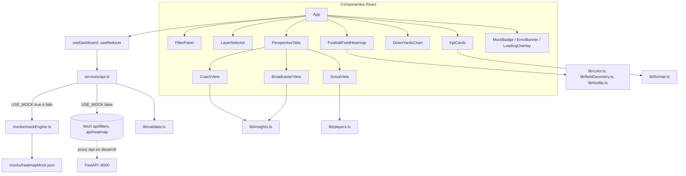
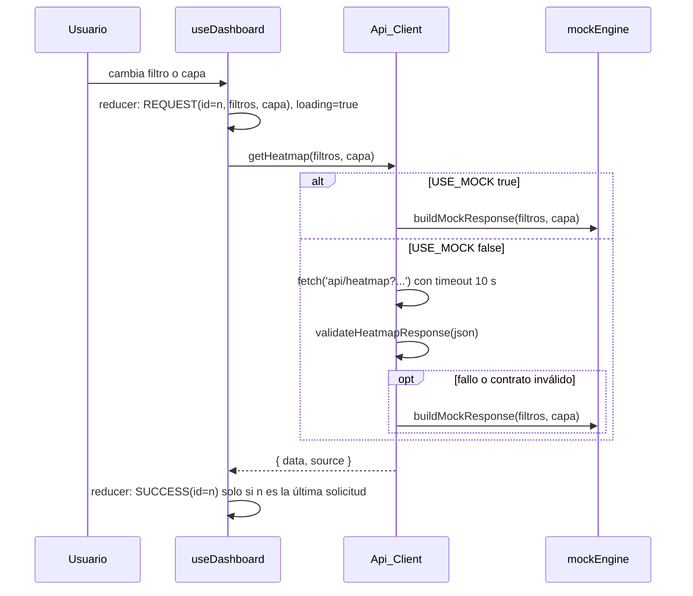

# Documento de Diseño: Dashboard de Mapa de Calor NFL

## Overview

El dashboard es una aplicación de una sola página en React 18.3.1 + TypeScript 5.7.3 (Vite 5.4.21, Tailwind CSS 3.4.19, Recharts 3.10.1) dentro de `dashboard/`. Muestra un campo de 120 × 53.3 yardas dibujado en SVG nativo, con una rejilla de celdas coloreadas según `intensity`, un panel de filtros, cinco tarjetas KPI, una gráfica de barras por down y tres perspectivas (Coach, Scout, Broadcaster).

Decisiones principales:

| Decisión | Motivo |
|---|---|
| Capa de datos (`services/api.ts`) desacoplada de la UI, con `USE_MOCK = true` | Req. 1. Los componentes solo conocen `getFilters` y `getHeatmap`. |
| Mocks en dos piezas: `heatmapMock.json` (datos base estáticos) y `mockEngine.ts` (derivación determinista por filtros) | Req. 2 y 7.11: el JSON es "realista" y validable, y el motor hace que cada filtro cambie KPIs y celdas sin guardar miles de respuestas. |
| Campo en SVG con `viewBox="0 0 120 53.3"` | La escala de yardas es el sistema de coordenadas. El escalado y la proporción los resuelve el navegador (Req. 3.7 sin JavaScript). |
| Lógica de dominio como funciones puras en `lib/` | Permite pruebas basadas en propiedades sin DOM. |
| Estado global con `useReducer` y un contador de solicitudes | Evita condiciones de carrera y conserva los datos previos ante fallos (Req. 6.7, 7.7). |
| Sin dependencias nuevas de producción | Regla del proyecto. Las propiedades se verifican con un script propio, ver Testing Strategy. |

### Investigación y hallazgos

- **Rutas y proxy.** `.kiro/steering/rules.md` exige `fetch('api/<ruta>')` sin diagonal inicial, sin `localhost` ni URLs absolutas, y un proxy de `/api` hacia `http://localhost:8000` en `vite.config.ts` con `base: './'`. Como `base` es `'./'`, una ruta relativa `api/heatmap` se resuelve contra la URL de la página y el proxy de Vite atiende `/api/...`. El código del dashboard nunca escribe `http://localhost:8000`; esa cadena vive solo en `vite.config.ts`.
- **Recharts 3.10.1.** Se usan `ResponsiveContainer`, `BarChart`, `Bar`, `XAxis`, `YAxis`, `CartesianGrid` y `Tooltip`, todos exportados por Recharts 3. `ResponsiveContainer` necesita un contenedor con altura explícita (por ejemplo `h-64`).
- **Importar JSON.** `resolveJsonModule` debe estar activo en `tsconfig.json` para `import mock from '../mocks/heatmapMock.json'`. Vite empaqueta el JSON en el bundle, por lo que no hay petición de red ni ruta de recurso que cuidar (Req. 1.6, 10.4). Se verifica en la primera tarea.
- **Hash marks.** Las filas a 23.58 y 29.72 yardas desde el borde superior vienen del Req. 3.5 y se usan tal cual.
- **Conflicto 1.8 frente a 6.7, 7.7 y 10.8.** Cuando el backend falla, el Api_Client devuelve Mock_Data (1.8), por lo que el usuario ve datos y el indicador "Datos simulados". Los mensajes de error con "Reintentar" aparecen solo cuando no se puede obtener ninguna respuesta válida, es decir, cuando falla también la validación del mock o ocurre una excepción inesperada. Esta interpretación se aplica en todo el diseño.
- **Extensión del contrato.** El Req. 8.4 pide yardas promedio por down, pero el contrato de `api/heatmap` del Req. 1 no tiene ese dato. El diseño agrega el campo opcional `yards_by_down` a Heatmap_Response. Si falta, la gráfica muestra "Sin datos" (Req. 8.6). El backend puede incorporarlo cuando exista.

## Architecture



### Estructura de archivos

```
dashboard/
  vite.config.ts            # proxy /api -> http://localhost:8000, base './'
  src/
    App.tsx, main.tsx, index.css          # index.css con @tailwind base/components/utilities
    types.ts                              # contrato de datos
    i18n/es.ts                            # todos los textos visibles
    services/api.ts                       # Api_Client, USE_MOCK
    mocks/heatmapMock.json                # datos base
    mocks/mockEngine.ts, mocks/prng.ts    # derivación determinista por filtros
    state/dashboardReducer.ts, state/useDashboard.ts
    lib/validate.ts, lib/filters.ts, lib/color.ts, lib/fieldGeometry.ts,
        lib/tooltip.ts, lib/format.ts, lib/insights.ts, lib/players.ts, lib/layers.ts
    components/ (un archivo por componente listado abajo)
```

### Flujo de una solicitud



## Components and Interfaces

### Contrato de datos (`types.ts`)

```ts
export type Layer = 'targets' | 'routes' | 'pocket_pressure' | 'separation'
export type PassResult = 'C' | 'I' | 'S' | 'R' | 'IN'
export type Down = '1st' | '2nd' | '3rd' | '4th'
export type Formation = 'SHOTGUN' | 'EMPTY' | 'SINGLEBACK' | 'I_FORM'
export type Coverage = 'Cover-1' | 'Cover-2' | 'Cover-3' | 'Quarters' | 'Man vs Zone'

export interface FilterState {          // arreglo vacío = sin selección = todas las opciones
  team: string[]; down: Down[]; formation: Formation[]
  coverage: Coverage[]; result: PassResult[]
}
export interface Meta {
  total_plays: number; avg_yards: number; completion_pct: number
  sack_rate: number; avg_time_to_throw: number
}
export interface GridCell {
  x_bin: number            // borde izquierdo en yardas, 0 a 115 en pasos de 5
  y_bin: number            // borde superior en yardas, k * 5.33 para k = 0..9
  intensity: number        // 0 a 1
  plays_count: number      // entero >= 0
  success_rate: number     // 0 a 1
  avg_epa_or_yards: number
}
export interface TopPlayer {
  nflId: number; name: string; position: 'QB'|'WR'|'TE'|'RB'|'CB'|'S'
  metric_value: number; metric_label: string
}
export interface DownYards { down: 1 | 2 | 3 | 4; avg_yards: number }
export interface HeatmapResponse {
  meta: Meta; grid: GridCell[]; top_players: TopPlayer[]
  yards_by_down?: DownYards[]                     // extensión opcional (ver investigación)
}
export interface FiltersResponse { teams: string[] }
export type DataSource = 'api' | 'mock'
export interface ApiResult<T> { data: T; source: DataSource }
```

`x_bin` y `y_bin` se interpretan como el borde superior izquierdo de la celda. Esta interpretación es la que usa también el backend futuro; si el backend usara centros de celda, el cambio queda aislado en `cellRect`.

### Rejilla

Constantes en `lib/fieldGeometry.ts`: `FIELD_W = 120`, `FIELD_H = 53.3`, `CELL_W = 5`, `CELL_H = 5.33` (53.3 / 10). La rejilla tiene 24 columnas × 10 filas = 240 celdas por capa. `x_bin = col * 5`, `y_bin = round2(row * 5.33)`. Todas las celdas tienen el mismo ancho y alto, no se solapan y cubren el campo completo (Req. 2.2, 4.1).

### Api_Client (`services/api.ts`)

```ts
export const USE_MOCK = true
export function getFilters(): Promise<ApiResult<FiltersResponse>>
export function getHeatmap(f: FilterState, layer: Layer): Promise<ApiResult<HeatmapResponse>>
export function buildHeatmapUrl(f: FilterState, layer: Layer): string   // pura
export function parseHeatmapUrl(url: string): { filters: FilterState; layer: Layer }  // pura
```

- `buildHeatmapUrl` devuelve `api/heatmap?layer=targets&team=KC,BUF&down=1st,2nd...` con valores codificados con `encodeURIComponent` y omite los filtros vacíos. Nunca empieza con `/` ni contiene `://`.
- Con `USE_MOCK = true`, ambas funciones llaman a `mockEngine` y no tocan `fetch` (Req. 1.6).
- Con `USE_MOCK = false`: `fetch` con `AbortController`. Timeout de 10 s para `api/heatmap` y 5 s para `api/filters` (Req. 7.10). Se acepta la respuesta si el estado es 2xx, el cuerpo es JSON válido y `validateHeatmapResponse` no reporta errores. Cualquier otro caso devuelve `{ data: mock, source: 'mock' }`. Las funciones no lanzan excepciones por fallos de red.
- Las llamadas se hacen con `fetch(buildHeatmapUrl(...))`, nunca con una URL absoluta.

### Validación (`lib/validate.ts`)

```ts
export interface ContractError { path: string; message: string }  // p. ej. "grid[17] (capa routes): intensity fuera de [0,1]"
export function validateHeatmapResponse(x: unknown, layerLabel?: Layer): ContractError[]
export function validateMockFile(m: MockFile): ContractError[]    // recorre las cuatro capas
```

Comprueba: campos de `meta` numéricos; `grid` con 240 celdas únicas en la rejilla esperada; rangos de `intensity` y `success_rate`; `plays_count` entero ≥ 0; `top_players` con 10 a 50 elementos y las seis posiciones; suma de `plays_count` ≤ `meta.total_plays`. Cada error incluye la capa y el índice de celda o jugador (Req. 2.8). `validateMockFile` además exige que las listas de `intensity` de las capas sean distintas entre sí (Req. 2.6). El validador no modifica sus entradas.

### Módulo de mocks dependientes de filtros

**`mocks/heatmapMock.json`** (datos base, estado de filtros vacío):

```ts
interface MockFile {
  filters: { teams: string[] }                          // opciones de respaldo de Equipo (Req. 7.10)
  layers: Record<Layer, HeatmapResponse>                // 4 respuestas completas, 240 celdas cada una
}
```

Cada capa tiene una forma espacial distinta, por ejemplo `targets` concentrada en 5 a 20 yardas pasadas la línea de golpeo y en las bandas, `pocket_pressure` cerca de la línea de golpeo, `routes` repartida en el medio y `separation` en la zona profunda. El archivo se genera una vez con un script de apoyo (no entregable) y se versiona; se revisa que pase `validateMockFile`.

**`mocks/prng.ts`**: `hash32(str)` (FNV-1a de 32 bits) y `mulberry32(seed)`, ambos deterministas y de unos pocos renglones, sin dependencias.

**`mocks/mockEngine.ts`**:

```ts
export function normalizeFilters(f: FilterState, options: FilterOptions): FilterState
export function buildMockResponse(f: FilterState, layer: Layer): HeatmapResponse   // pura y determinista
export function getMockFilters(): FiltersResponse
```

Algoritmo de `buildMockResponse`:

1. `n = normalizeFilters(f)`. Una dimensión con todas sus opciones seleccionadas se convierte en vacía (Req. 7.8). Con `n` vacío se devuelve la base de la capa sin cambios.
2. Para cada valor seleccionado `v` de la dimensión `d` se calcula `h(d,v) = hash32(d + ':' + v) / 2^32` ∈ [0,1). Con `h` se obtienen un multiplicador global `g(d,v) = 0.6 + 0.8·h` y, por celda, un multiplicador local `c(d,v,i) = 0.7 + 0.6·hash32(d:v:layer:i)/2^32`.
3. Sea `G` el promedio de los `g` de todos los valores seleccionados y `C_i` el promedio de los `c` de la celda `i`. Se calcula:
   - `plays_count' = round(base.plays_count · G · C_i)`
   - `intensity' = clamp01(base.intensity · C_i)`
   - `success_rate' = clamp01(base.success_rate + 0.08·(C_i − 1))`
   - `avg_epa_or_yards' = round1(base.avg_epa_or_yards · C_i)`
4. `meta`: se parte de `meta` base; `avg_yards`, `completion_pct`, `sack_rate` y `avg_time_to_throw` se desplazan en función de `G` con límites razonables (por ejemplo `completion_pct` en [0,100]); `total_plays = max(sumaPlays de las 4 capas derivadas, round(base.total_plays · G))`, de modo que la suma de cada capa siempre sea ≤ `total_plays` (Req. 2.7). Como `buildMockResponse` calcula una sola capa, `total_plays` usa `max(suma de la capa solicitada, round(base.total_plays·G)) ` y la base se diseña con `base.total_plays` mayor que la suma de cada capa con margen ≥ 1.4 × (cota superior de `G·C_i`).
5. `top_players`: mismas filas con `metric_value' = round1(metric_value · G_p)` donde `G_p` se obtiene con `hash32(d:v:nflId)`. Se conservan nombre, posición y etiqueta.
6. `yards_by_down`: base por down desplazada por `G`.

Con el estado vacío no se aplica ninguna transformación, de modo que "restablecer" regresa a los datos base (Req. 7.9). Las constantes de rango (0.6, 0.8, 0.7, 0.6) garantizan intensidades y tasas válidas por construcción gracias a `clamp01`. Si la propiedad 5 encuentra una colisión de hash que deje KPIs o celdas sin cambio, se corrige añadiendo una sal por dimensión; el criterio 7.11 prevalece sobre la forma exacta de los factores.

### Estado (`state/dashboardReducer.ts`)

```ts
interface DashboardState {
  filters: FilterState
  layer: Layer                       // activa, inicial 'targets'
  perspective: 'coach' | 'scout' | 'broadcaster'   // inicial 'coach'
  data: HeatmapResponse | null       // últimos datos mostrados
  source: DataSource
  loading: boolean
  error: string | null
  filterOptions: FiltersResponse | null
  filterNotice: boolean              // aviso de opciones de respaldo (Req. 7.10)
  requestId: number
}
type Action =
  | { type: 'SET_FILTERS'; filters: FilterState } | { type: 'RESET_FILTERS' }
  | { type: 'SELECT_LAYER'; layer: Layer } | { type: 'SELECT_PERSPECTIVE'; p: Perspective }
  | { type: 'REQUEST'; id: number } | { type: 'SUCCESS'; id: number; result: ApiResult<HeatmapResponse>; layer: Layer }
  | { type: 'FAILURE'; id: number; message: string } | { type: 'RETRY' }
```

Reglas: `SELECT_LAYER` no cambia la capa activa hasta recibir `SUCCESS`; se guarda la capa solicitada en la solicitud pendiente (Req. 6.2, 6.7). `SUCCESS` y `FAILURE` con `id` distinto de `requestId` se ignoran (respuesta obsoleta). `FAILURE` conserva `data`, `layer` y `filters` y asigna `error`. `SELECT_PERSPECTIVE` no toca `filters` (Req. 9.8). `useDashboard` ejecuta los efectos (llamadas al Api_Client) y expone `retry`.

### Componentes

| Componente | Responsabilidad | Props principales |
|---|---|---|
| `App` | Composición y layout (Tailwind, rejilla responsiva 768 a 2560 px) | ninguna |
| `FilterPanel` | 5 filtros multi-selección, botón "Restablecer", aviso de respaldo | `options`, `value`, `onChange`, `onReset`, `notice` |
| `LayerSelector` | 4 botones con la capa activa marcada (`aria-pressed`) | `active`, `onSelect` |
| `FootballFieldHeatmap` | SVG del campo, celdas, tooltip, leyenda, overlay de carga | `grid`, `layer`, `loading` |
| `FieldMarkings` | Fondo, end zones, líneas, números, hash marks, flecha | ninguna (usa constantes) |
| `HeatCells` | `<rect>` por celda con `fill` de `intensityToColor` | `grid` |
| `CellTooltip` | Globo con jugadas, % de éxito y yardas/EPA | `cell`, `layer`, `position` |
| `ColorLegend` | Gradiente SVG con las mismas paradas, etiquetas "0" y "1" | ninguna |
| `KpiCards` | 5 tarjetas | `meta` |
| `DownYardsChart` | Recharts `BarChart` | `data` |
| `PerspectiveTabs` | Selector y vista activa | `value`, `onChange` |
| `CoachView`, `ScoutView`, `BroadcasterView` | Vistas por rol | `filters`, `meta`, `players` |
| `MockBadge`, `ErrorBanner` | "Datos simulados"; error con "Reintentar" | `source`, `message`, `onRetry` |

### Función de color (`lib/color.ts`)

```ts
export const COLOR_STOPS = [
  { t: 0,    rgb: [253, 224, 71],  a: 0    },  // traslúcido (el RGB evita pasar por gris)
  { t: 0.33, rgb: [253, 224, 71],  a: 0.55 },  // amarillo
  { t: 0.66, rgb: [249, 115, 22],  a: 0.75 },  // naranja
  { t: 1,    rgb: [185, 28, 28],   a: 0.9  },  // rojo intenso
] as const
export function clamp01(x: number): number          // NaN -> 0
export function intensityToRgba(i: number): { r: number; g: number; b: number; a: number }
export function intensityToCss(i: number): string   // 'rgba(r,g,b,a)'
export function legendGradientStops(): { offset: string; color: string }[]  // misma tabla
```

`intensityToRgba` limita `i` con `clamp01` (Req. 4.4), localiza el tramo y interpola linealmente RGB y alfa. Con `i = 0` el alfa es exactamente 0 (Req. 4.3). La opacidad crece de forma no decreciente porque las paradas de `a` son crecientes (Req. 4.7). La leyenda usa `COLOR_STOPS`, por lo que comparte escala con las celdas (Req. 4.5).

### Geometría del campo (`lib/fieldGeometry.ts`)

Sistema de coordenadas: `x` en yardas de 0 a 120 (izquierda a derecha), `y` en yardas de 0 a 53.3 (de arriba hacia abajo). SVG: `viewBox="0 0 120 53.3"`, `width="100%"`, `preserveAspectRatio="xMidYMid meet"`.

| Elemento | Cálculo |
|---|---|
| Campo de juego | `rect x=10 y=0 width=100 height=53.3` |
| End zones | `rect x=0 width=10` y `rect x=110 width=10`, altura 53.3, relleno distinto (Req. 3.2) |
| Líneas de yarda | `x = 10, 15, …, 110` (21 líneas) `y1=0 y2=53.3` (Req. 3.3) |
| Números | `[10,20,30,40,50,40,30,20,10]` en `x = 20, 30, …, 100`, centrados con `text-anchor="middle"` (Req. 3.4) |
| Hash marks | para cada `x` entero de 10 a 110 (101 marcas por fila), segmentos cortos en `y = 23.58` y `y = 29.72` (Req. 3.5) |
| Flecha | polígono centrado apuntando a `+x`, dentro del campo (Req. 3.6) |
| Celda | `cellRect(cell) = { x: x_bin, y: y_bin, w: 5, h: 5.33 }` |

```ts
export function fieldSize(containerWidth: number): { width: number; height: number }
// width = max(containerWidth, 320); height = width * 53.3 / 120  (Req. 3.1, 3.7, 3.8)
export const yardLineXs: number[]; export const yardNumbers: { x: number; label: string }[]
export function hashMarks(): { x: number; y: number }[]
export function cellRect(c: Pick<GridCell,'x_bin'|'y_bin'>): { x: number; y: number; w: number; h: number }
```

El contenedor del campo usa `overflow-x-auto` y el SVG un `min-width: 320px` (Req. 3.8). Como el SVG escala con `viewBox`, el redimensionado ocurre en el mismo fotograma del cambio de ancho (Req. 3.7).

### Tooltip (`lib/tooltip.ts`, `lib/layers.ts`, `lib/format.ts`)

```ts
export function tooltipPosition(
  cursor: {x:number;y:number}, tip: {w:number;h:number},
  box: {w:number;h:number}, offset = 12, margin = 4
): { left: number; top: number }
```

Posición preferida: `(cursor.x + 12, cursor.y + 12)`. Cada eje se acota a `[margin, box − tip − margin]`; si el tooltip no cabe en el contenedor, se fija en `margin` (Req. 5.1, 5.4, 5.7). El componente mide el globo con `ref` y calcula la posición en `onMouseMove` del SVG, de modo que el tooltip sigue al cursor sin retardo medible. `mouseenter` y `mouseleave` sobre `<rect>` y sobre el SVG actualizan o ocultan el tooltip (Req. 5.5, 5.6).

`lib/layers.ts` define para cada capa su nombre en español y la etiqueta de la métrica del tooltip, con etiquetas distintas:

| Capa | Nombre | Etiqueta de métrica |
|---|---|---|
| targets | Zonas de Recepción | Yardas promedio |
| routes | Rutas de Receptores | Yardas por ruta |
| pocket_pressure | Presión al QB | EPA promedio |
| separation | Separación Receptor-Defensor | Separación promedio (yd) |

`formatCellTooltip(cell, layer)` devuelve `{ plays: string; success: string; metric: string; label: string }`: con `plays_count > 0`, `success = (rate·100).toFixed(1) + ' %'` y `metric = avg.toFixed(1)`; con 0 jugadas, `plays = '0'` y ambos valores `"Sin datos"` (Req. 5.2, 5.3, 6.5).

### KPIs, gráfica, vistas

- `format.ts`: `formatKpis(meta: Partial<Record<keyof Meta, unknown>>)` devuelve cinco `{ key, label, unit, text }`. Enteros para `total_plays`; 1 decimal para `avg_yards`, `completion_pct`, `sack_rate`; 2 decimales para `avg_time_to_throw`; `"N/D"` si el valor es nulo, ausente o no finito, sin afectar a los demás (Req. 8.1, 8.3). Valores de porcentaje fuera de [0,100] también se muestran como `"N/D"`.
- `toBarData(yards_by_down?)` devuelve `{ down: string; avg_yards: number }[]` ordenado por down, con a lo sumo 4 elementos (se descartan duplicados y downs fuera de 1 a 4). Una lista vacía o ausente produce `[]`, y `DownYardsChart` muestra "Sin datos" conservando título y ejes (Req. 8.4, 8.6). La gráfica usa `<XAxis label>` "Down" y `<YAxis label>` "Yardas promedio".
- `insights.ts`: `coachRecommendation(filters, meta): string | null` y `broadcastSummary(meta): string | null`. Ambas son reglas determinísticas sobre plantillas en español. La recomendación elige hasta 3 frases según `completion_pct`, `sack_rate`, `avg_time_to_throw` y los filtros activos (por ejemplo cobertura o down seleccionados), y recorta a 300 caracteres. Devuelven `null` si `meta` no está disponible o tiene campos no finitos; la vista muestra "Recomendación no disponible" (Req. 9.9). El resumen es una sola frase de ≤ 200 caracteres con `total_plays` entero, `avg_yards.toFixed(1)` y `completion_pct.toFixed(1) + ' %'`.
- `players.ts`: `visiblePlayers(players)` toma las primeras 20; `sortPlayers(players, dir)` devuelve una copia ordenada por `metric_value`. `ScoutView` guarda `dir`, que empieza en `'desc'` en la primera activación del encabezado y alterna (Req. 9.5). Sin jugadores, muestra "Sin jugadores destacados" sin encabezados (Req. 9.7).

### Configuración

`vite.config.ts`:

```ts
import { defineConfig } from 'vite'
import react from '@vitejs/plugin-react'

export default defineConfig({
  base: './',
  plugins: [react()],
  server: { proxy: { '/api': 'http://localhost:8000' } },
})
```

`index.css` solo usa `@tailwind base; @tailwind components; @tailwind utilities;`. Los recursos propios usan rutas relativas sin `/` inicial. Todos los textos visibles salen de `i18n/es.ts`. Paleta oscura con texto claro; los pares texto/fondo usados se comprueban con una función `contrastRatio` en una prueba de ejemplo (Req. 10.7).

## Data Models

Resumen de las estructuras (definidas arriba en `types.ts`):

| Modelo | Campos clave | Restricciones |
|---|---|---|
| `FilterState` | 5 arreglos | Vacío equivale a todas las opciones. Valores de `down`, `formation`, `coverage`, `result` pertenecen a sus enumeraciones. |
| `Meta` | 5 números | `completion_pct` y `sack_rate` en [0,100]; `total_plays` entero ≥ 0 |
| `GridCell` | 6 números | 240 celdas únicas por capa; `intensity` y `success_rate` en [0,1]; `plays_count` entero ≥ 0 |
| `TopPlayer` | 5 campos | 10 a 50 jugadores, con QB, WR, TE, RB, CB y S |
| `HeatmapResponse` | `meta`, `grid`, `top_players`, `yards_by_down?` | Σ `plays_count` ≤ `meta.total_plays` |
| `DashboardState` | ver reductor | `layer` siempre una de las 4 capas |
| `MockFile` | `filters.teams`, `layers` (4 × `HeatmapResponse`) | Pasa `validateMockFile`; intensidades distintas entre capas |

Parámetros de URL de `api/heatmap`: `layer` (obligatorio) y `team`, `down`, `formation`, `coverage`, `result` (listas separadas por coma, omitidos si están vacíos). `api/filters` no recibe parámetros y devuelve `{ "teams": [...] }`.

## Correctness Properties

*A property is a characteristic or behavior that should hold true across all valid executions of a system-essentially, a formal statement about what the system should do. Properties serve as the bridge between human-readable specifications and machine-verifiable correctness guarantees.*

### Reflexión de propiedades

- Los criterios 2.1, 2.3, 2.4, 2.5 y 2.7 se consolidan en una sola propiedad (salida del motor cumple el contrato e invariantes).
- 3.1, 3.7 y 3.8 se consolidan en una propiedad de `fieldSize`.
- 5.1, 5.4 y 5.7 se consolidan en una propiedad de `tooltipPosition`.
- 6.2, 6.4, 6.7, 7.6, 7.7 y 9.8 se consolidan en dos propiedades del reductor (última solicitud gana y fallos conservan estado; cambio de perspectiva conserva filtros).
- 4.3 y 4.4 se consolidan en la propiedad de recorte y valor cero. 4.7 (monotonía) y 4.2 (interpolación) se mantienen separadas porque validan cosas distintas.
- 9.2 y 9.3 se consolidan con 9.6 solo en estilo; se mantienen dos propiedades por funciones distintas.
- 1.2 y 1.3 se consolidan en la propiedad de URL (round trip más forma relativa).

### Property 1: Validador del contrato identifica violaciones

Para toda `HeatmapResponse` válida generada, `validateHeatmapResponse` devuelve cero errores. Para toda respuesta obtenida mutando exactamente un campo (eliminar un campo requerido, cambiar su tipo, sacar `intensity` o `success_rate` de [0,1], poner `plays_count` negativo o fraccionario, duplicar una celda), devuelve al menos un error cuyo `path` identifica la capa (si se indicó) y el índice de la celda o jugador afectado.

**Validates: Requirements 1.10, 2.1, 2.8**

### Property 2: La salida del motor de mocks cumple el contrato e invariantes

Para todo `FilterState` y toda `Layer`, `buildMockResponse(f, layer)` pasa `validateHeatmapResponse` sin errores; todas sus celdas tienen `intensity` y `success_rate` en [0,1], `plays_count` entero ≥ 0 y `avg_epa_or_yards` finito; `top_players` tiene entre 10 y 50 elementos con las seis posiciones; y la suma de `plays_count` es ≤ `meta.total_plays`.

**Validates: Requirements 2.1, 2.3, 2.4, 2.5, 2.7**

### Property 3: La rejilla de cada capa es completa y sin duplicados

Para todo `FilterState` y toda `Layer`, la rejilla contiene exactamente 240 celdas con pares (`x_bin`, `y_bin`) únicos, que son exactamente el producto de `x_bin ∈ {0,5,…,115}` y `y_bin ∈ {round2(k·5.33) : k = 0..9}`.

**Validates: Requirements 2.2**

### Property 4: El mock es determinista y depende de cada filtro

Para todo `FilterState` `f`, `buildMockResponse(f, layer)` produce el mismo resultado en dos llamadas. Para todo par de estados `f1`, `f2` con `normalizeFilters(f1) ≠ normalizeFilters(f2)`, las respuestas para la misma capa difieren en al menos un valor de `meta` y en al menos una celda.

**Validates: Requirements 7.11**

### Property 5: Normalización de filtros

Para todo `FilterState`, una dimensión con todas sus opciones seleccionadas es equivalente a una dimensión vacía: `buildMockResponse` devuelve la misma respuesta, `normalizeFilters` es idempotente (`normalize(normalize(f)) = normalize(f)`) y el estado vacío devuelve la respuesta base de la capa. Para toda lista de equipos con duplicados, la lista mostrada no tiene duplicados y conserva el orden de primera aparición.

**Validates: Requirements 7.1, 7.8, 7.9**

### Property 6: Escala de color monótona en opacidad

Para todo par de intensidades `a ≤ b` en [0,1], `intensityToRgba(a).a ≤ intensityToRgba(b).a`, y todos los canales del resultado están en su rango válido (RGB en [0,255], alfa en [0,1]).

**Validates: Requirements 4.7**

### Property 7: Interpolación, recorte y valor cero del color

Para todo `i` real (incluidos valores menores que 0, mayores que 1 y `NaN`), `intensityToRgba(i)` es igual a `intensityToRgba(clamp01(i))`. Para todo `i` dentro de un tramo entre dos paradas consecutivas, cada canal es la interpolación lineal de los canales de las paradas. En `i = 0` el alfa es 0, y en 0.33, 0.66 y 1 el color es exactamente el de la parada correspondiente.

**Validates: Requirements 4.2, 4.3, 4.4**

### Property 8: Las celdas embaldosan el campo sin solaparse

Para toda rejilla completa, los rectángulos de `cellRect` tienen todos el mismo ancho y alto, quedan dentro de [0,120] × [0,53.3] (con tolerancia de 1e-6), no se solapan entre sí, y su área total es igual a 120 × 53.3 (con tolerancia de 1e-6).

**Validates: Requirements 4.1**

### Property 9: Tamaño del campo conserva la proporción

Para todo ancho de contenedor `w` (≥ 0), `fieldSize(w).width = max(w, 320)` y `fieldSize(w).height / fieldSize(w).width` difiere de 53.3/120 en menos de 0.5 %.

**Validates: Requirements 3.1, 3.7, 3.8**

### Property 10: Posición del tooltip

Para todo cursor, todo tamaño de tooltip y todo contenedor tales que el tooltip cabe con margen (`tip + 2·4 ≤ box` en cada eje), `tooltipPosition` devuelve un rectángulo con los cuatro bordes a al menos 4 px de los bordes del contenedor; y si la posición preferida (`cursor + 12`) ya cumple esa condición, el resultado es exactamente `cursor + 12`.

**Validates: Requirements 5.1, 5.4, 5.7**

### Property 11: Contenido del tooltip

Para toda `GridCell` y toda `Layer`, si `plays_count > 0` el texto contiene el número de jugadas como entero, el porcentaje de éxito con exactamente 1 decimal y la métrica con exactamente 1 decimal, junto con la etiqueta de la capa; si `plays_count = 0` el texto muestra `0` y "Sin datos" y no contiene porcentaje ni métrica numérica. Las etiquetas de métrica de las cuatro capas son distintas entre sí.

**Validates: Requirements 5.2, 5.3, 6.5**

### Property 12: Formato de KPIs

Para todo objeto `Meta` cuyos campos pueden ser números, nulos, ausentes o no numéricos, `formatKpis` devuelve exactamente cinco tarjetas con su etiqueta y unidad; cada campo válido se muestra con su formato (entero, 1 decimal o 2 decimales) y cada campo inválido muestra "N/D" sin alterar el texto de las demás tarjetas.

**Validates: Requirements 8.1, 8.3**

### Property 13: Datos de la gráfica por down

Para toda lista `yards_by_down` (incluida ausente, vacía, con duplicados y con downs fuera de 1 a 4), `toBarData` devuelve a lo sumo 4 elementos ordenados por down ascendente, sin duplicados, con downs en {1,2,3,4}; y devuelve `[]` si la lista es ausente o vacía.

**Validates: Requirements 8.4, 8.6**

### Property 14: Recomendación del Coach

Para todo `FilterState` y todo `Meta` válido, `coachRecommendation` devuelve un texto de entre 1 y 3 frases y como máximo 300 caracteres, idéntico en dos llamadas con las mismas entradas. Para todo `Meta` con algún campo no finito o ausente devuelve `null`.

**Validates: Requirements 9.2, 9.3, 9.9**

### Property 15: Resumen del Broadcaster

Para todo `Meta` válido, `broadcastSummary` devuelve una sola frase de como máximo 200 caracteres que contiene `total_plays` como entero, `avg_yards` con 1 decimal y `completion_pct` con 1 decimal seguido de `%`.

**Validates: Requirements 9.6**

### Property 16: Tabla del Scout

Para toda lista de `TopPlayer`, `visiblePlayers` devuelve a lo sumo 20 filas y `sortPlayers(lista, 'desc')` es una permutación ordenada de forma no creciente por `metric_value`; `sortPlayers(lista, 'asc')` es la ordenada de forma no decreciente; y alternar la dirección dos veces devuelve el orden descendente original.

**Validates: Requirements 9.4, 9.5**

### Property 17: Api_Client con respaldo

Para todo `FilterState` y toda `Layer`: con `USE_MOCK = true`, `fetch` se invoca 0 veces y el resultado tiene `source = 'mock'`. Con `USE_MOCK = false`, para todo modo de fallo (error de red, estado distinto de 2xx, ausencia de respuesta en 10 s, cuerpo que no es JSON, cuerpo JSON que viola el contrato) el resultado es una respuesta de mock válida con `source = 'mock'` y la función no lanza excepciones; y para toda respuesta 2xx válida el resultado es esa respuesta con `source = 'api'`.

**Validates: Requirements 1.6, 1.7, 1.8, 1.10**

### Property 18: URL de la API relativa y reversible

Para todo `FilterState` y toda `Layer`, `buildHeatmapUrl` devuelve una cadena que no empieza con `/`, no contiene `://` ni `localhost`, empieza con `api/heatmap`, y `parseHeatmapUrl(buildHeatmapUrl(f, l))` es igual a `(f, l)` con los arreglos en el mismo orden.

**Validates: Requirements 1.2, 1.3**

### Property 19: Reductor del dashboard

Para toda secuencia de acciones (solicitudes, éxitos y fallos que llegan en cualquier orden), el estado cumple siempre: exactamente una capa de las 4 está activa; los datos mostrados corresponden a la última solicitud aceptada con éxito y las respuestas con `id` obsoleto no modifican el estado; un `FAILURE` deja `data`, `layer` y `filters` sin cambio y asigna un mensaje de error; y `SELECT_PERSPECTIVE` deja `filters` sin cambio.

**Validates: Requirements 6.2, 6.4, 6.7, 7.6, 7.7, 9.8**

## Error Handling

| Situación | Comportamiento |
|---|---|
| Red caída, HTTP no 2xx, timeout (10 s heatmap, 5 s filtros) | `Api_Client` devuelve Mock_Data con `source = 'mock'`; se muestra "Datos simulados"; se conservan filtros y capa (Req. 1.8, 1.9) |
| Cuerpo no JSON o contrato violado | Igual que el caso anterior (Req. 1.10) |
| Éxito posterior del backend | `source = 'api'`; el indicador se oculta en el mismo render (≤ 1 s, Req. 1.11) |
| `api/filters` falla | Opciones de Equipo de `heatmapMock.json` y aviso de opciones de respaldo (Req. 7.10) |
| Ni el backend ni el mock producen datos válidos (excepción inesperada, mock inválido) | Acción `FAILURE`: se conservan datos y filtros previos, `ErrorBanner` en español con "Reintentar" en ≤ 1 s (Req. 6.7, 7.7, 10.8). `RETRY` repite la última solicitud y oculta el error si tiene éxito (Req. 10.9) |
| Respuesta obsoleta (llega después de una solicitud más reciente) | Se ignora por `id` |
| Valor de `intensity` fuera de [0,1] o `NaN` | `clamp01` en `intensityToRgba` (Req. 4.4) |
| `Meta` con campos inválidos | "N/D" por tarjeta; `coachRecommendation` devuelve `null` y la vista muestra el mensaje de no disponible |
| Celda sin jugadas | Tooltip con "Sin datos" |
| Contenedor menor de 320 px | Ancho del campo fijo en 320 px con desplazamiento horizontal del contenedor |
| `yards_by_down` ausente o vacío | "Sin datos" en la gráfica |

## Testing Strategy

**Enfoque dual.** Pruebas de propiedades para la lógica pura de `lib/`, `mocks/`, `services/` y `state/` (Propiedades 1 a 19), y pruebas de ejemplo o de humo para el resto: estructura de la interfaz (selector de capas, opciones de cada filtro, perspectiva inicial, indicador de carga, "Datos simulados", leyenda con "0" y "1", tooltip al entrar y salir), configuración (`vite.config.ts` con proxy y `base: './'`, `USE_MOCK = true`, `index.css` con directivas de Tailwind 3, ausencia de `fetch('/api` y de `localhost` en `src/`), geometría fija del campo (21 líneas, números, 101 hash marks por fila, end zones) y contraste de la paleta con `contrastRatio` (Req. 10.7). Los Req. 10.1 y 10.2 se verifican ejecutando `npm run dev` y `npm run build`; el Req. 10.6 y la tolerancia de redimensionado visual se revisan manualmente en el navegador entre 768 y 2560 px.

**Por qué no se aplican propiedades a la UI.** Renderizado SVG, diseño responsivo y gráfica Recharts no tienen una afirmación "para todo X" útil. Se prueban con ejemplos y revisión visual. El Api_Client usa `fetch` simulado, de modo que sus propiedades no dependen de una red real.

**Verificación de propiedades sin dependencias nuevas.** No se agrega ninguna dependencia (ni ejecutor de pruebas ni biblioteca de propiedades); se mantiene estrictamente el stack instalado. Las 19 propiedades se verifican con un script en TypeScript puro, `dashboard/src/verify/properties.ts`, con un generador pseudoaleatorio propio con semilla (`mulberry32`, reutilizado de `mocks/prng.ts`). El script no se importa desde `main.tsx` ni forma parte del bundle de producción.

- **Ejecución.** Se usan solo Vite 5.4.21 (ya instalado) para empaquetar el script y Node para ejecutarlo. Se agrega a `package.json` únicamente un script npm, sin paquetes nuevos: `"verify": "vite build --ssr src/verify/properties.ts --outDir .verify && node .verify/properties.js"`. Vite resuelve la importación de `heatmapMock.json` y las rutas sin extensión, así que no se depende de que Node ejecute TypeScript directamente. `.verify/` se agrega a `.gitignore`. El script termina con código de salida distinto de 0 si alguna propiedad falla.
- **Alternativa si el script npm no funciona en el entorno.** Una página de verificación interna, accesible solo en modo desarrollo (`import.meta.env.DEV`, ruta `#verificacion`, cargada con `import()` dinámico), que ejecuta las mismas propiedades en el navegador y muestra el resultado por propiedad y en la consola. No se incluye en el bundle de producción.
- **Comprobación de tipos.** `npm run build` (`tsc --noEmit && vite build`) y `npm run typecheck` comprueban los tipos de todo `src/`, incluido `verify/`.

**Configuración del script de verificación.**
- Mínimo 100 casos por propiedad, con semilla fija por defecto (`SEED = 12345`) y semilla opcional por variable de entorno o parámetro de URL para reproducir un fallo.
- Cada propiedad es una función `(rng) => void` que lanza un error con el contraejemplo. Un ayudante `check(n, titulo, fn)` ejecuta los 100 casos y, ante un fallo, informa la semilla, el número de caso y la entrada. No se implementa reducción de contraejemplos.
- Cada propiedad lleva un comentario con el formato: `Feature: nfl-heatmap-dashboard, Property {n}: {texto de la propiedad}`.
- Generadores propios: `genFilterState` (subconjuntos de las opciones, con y sin selección completa), `genLayer`, `genMeta` (con variantes inválidas), `genGridCell`, `genTopPlayers`, `genHeatmapResponse` (válida) y `genMutation` (una mutación por caso).
- Para el Api_Client, `fetch` se sustituye por una función simulada inyectable y el timeout se prueba con un plazo inyectable reducido, sin temporizadores falsos de bibliotecas externas.

**Pruebas de ejemplo prioritarias.** Estado inicial (`targets`, `coach`, `USE_MOCK = true`); validación del archivo `heatmapMock.json` con `validateMockFile` (incluye Req. 2.6, intensidades distintas por capa); lista exacta de líneas de yarda y números; `RESET_FILTERS` deja los cinco filtros vacíos; acción `RETRY` tras error; render de `ScoutView` con lista vacía.
