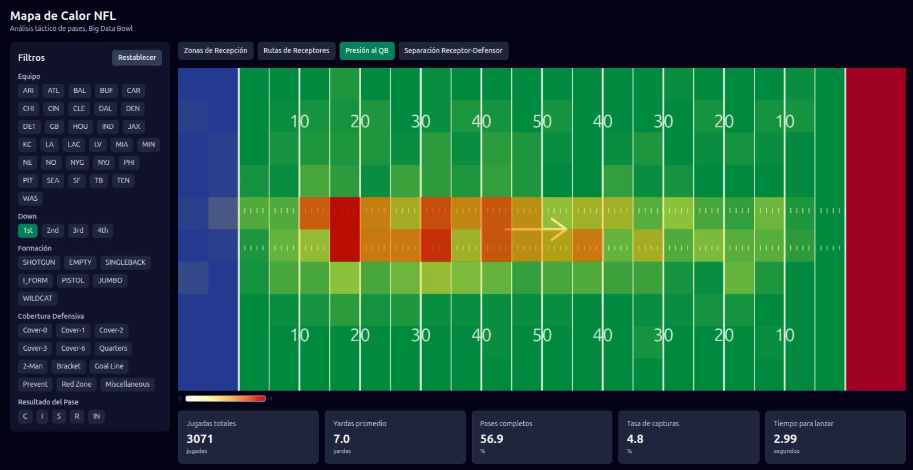

# NFL Big Data Bowl — Mapa de Calor Táctico (`newton-futbol-locura`)

## Resumen del Proyecto y Equipo
* **Equipo**: Carlos Daniel Guillén Meléndez (`carlosguillen-phys` — Pipeline ETL de 8.3M filas y API FastAPI) & Angélica Cerqueda (`AnG1e-25` — Dashboard React/Vite y visualización espacial).
* **Frontend (`dashboard/`)**: Ejecutar `cd dashboard && npm install && npm run dev` para abrir la interfaz interactiva en `http://localhost:5173`.

---

# NFL Big Data Bowl: ETL y API de heatmap

Pipeline que perfila, limpia y agrega los datos de tracking de la NFL (carpeta `data/`) y los expone con FastAPI:
`GET /health`, `GET /api/filters` y `GET /api/heatmap`.

Todos los comandos se ejecutan desde la raíz del proyecto y usan el entorno `.venv`.

## Comandos

| Qué hace | Comando |
|---|---|
| Perfilar los datos y generar `DATA_REPORT.md` | `.venv/bin/python -m backend.scripts.profile_data` |
| Persist_Run: construir las tablas y guardarlas en `data/processed/` | `.venv/bin/python -m backend.etl.clean_pipeline` |
| Levantar la API en desarrollo | `.venv/bin/uvicorn backend.main:app --port 8000` |
| Correr las pruebas | `.venv/bin/pytest` |

El perfilador lee `data/` en modo solo lectura y escribe únicamente `DATA_REPORT.md`. Termina con código distinto de cero si falta un archivo o `data/tracking/` está vacío.

## Datos procesados (`data/processed/`)

- `data/processed/` está excluido por `.gitignore`, por lo que **no se entrega** con el proyecto. Quitar esa línea de `.gitignore` es una decisión del equipo.
- Sin esos archivos, el servidor **reconstruye el almacén de tablas en memoria al arrancar** (aproximadamente 15 a 30 s). Durante ese tiempo `/health` responde 200 y los endpoints de datos responden 503.
- Para que los reinicios posteriores carguen los archivos en lugar de recalcular, hay que ejecutar el Persist_Run **localmente**: `.venv/bin/python -m backend.etl.clean_pipeline`. Genera nueve archivos `*.pkl.gz` (escritura en archivo temporal y renombrado atómico).
- La API solo lee `data/processed/` al arrancar y nunca escribe en disco. Si falta algún archivo o no se puede leer, construye todo en memoria sin modificar la carpeta.
- Los archivos originales de `data/` nunca se modifican.

## Enmiendas propuestas a los requisitos (el equipo debe confirmarlas)

Los datos reales hacen que el texto literal de algunos requisitos produzca resultados vacíos o ambiguos. Cada punto es reversible mediante una constante en `backend/etl/constants.py` o un parámetro.

| # | Propuesta | Si se rechaza |
|---|---|---|
| A | Eventos: gana `ball_snap` / `pass_forward`; si faltan se usa su alias `autoevent_ballsnap` / `autoevent_passforward`. | `USE_AUTOEVENTS = False`. Suben las jugadas sin evento de lanzamiento (de 953 a más de 1,000). |
| B | Las capas `targets`, `routes` y `separation` usan como cuadro de análisis `pass_arrived` y, si no existe, el último cuadro rastreado (0.5 s tras el lanzamiento). `arrival_source` guarda cuál se usó. Solo 367 jugadas (4.3%) tienen `pass_arrived`. | `allow_last_frame_fallback=False`: las tres capas cubren solo 367 jugadas. |
| C | `pocket_pressure` excluye solo las jugadas que carecen de `pass_forward` y de `ball_snap` a la vez (los requisitos 11.9 y 11.22 se contradicen). | Lectura estricta: se excluye si falta cualquiera de los dos. |
| D | Se agregan las tablas `rushers` y `players` (nueve tablas y nueve archivos en lugar de siete) para el ranking de presión y los nombres. | Calcularlas desde `pffScoutingData` y `players.csv` al arrancar, fuera del almacén. |
| E | El ranking de presión lista solo jugadores con valor mayor que 0. | Incluir jugadores con 0 ordenados por nombre. |
| F | La fase (`pre_snap`, `pocket_phase`, `ball_in_air`, `yac_phase`) no es una columna almacenada: es función pura de `frameId` y de las columnas de frontera en `plays`. | Agregar una columna `phase` y enmendar el requisito 4.2. |
| G | El pipeline no carga `o` ni `dir` (ninguna tabla los usa). La función de normalización y sus pruebas sí los cubren. | Agregar `o` y `dir` a `TRACKING_COLS` y a una tabla. |
| H | Las propiedades se prueban con bucles de pytest y un generador numpy con semilla (100 o más iteraciones), sin Hypothesis. | Aprobar Hypothesis como dependencia. |

## Estructura relevante

- `backend/main.py`: app FastAPI (`/health`, `/api/filters`, `/api/heatmap`).
- `backend/etl/`: normalización, fases, métricas, inferencia de receptor objetivo y `clean_pipeline.py`.
- `backend/store.py`: guardado y carga de las tablas, y arranque con carga o construcción en memoria.
- `backend/scripts/profile_data.py`: perfilador de datos.
- `backend/tests/`: pruebas.
